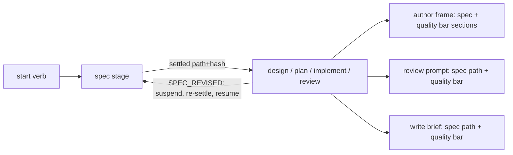

# Canonical session spec as the governing basis for dispatch

> **TL;DR:** Add a lintable, approved session spec as a driver-enforced stage before design, plan, objective-driven implement, and review; restructure design/plan to strategy/tactics layers that reference it; give every author, writer, and reviewer the spec and one kind-sectioned quality bar.
>
> **Parent:** `.scratch/dispatch-skills/20261015T0709Z-canonical-spec-as-the-governing-basis-fo/canonical-spec.spec.md` · sha256:bae700923592377b506c0df9ecff1817f9eb61724969a39fb9b69cfa7d249d1f
>
> **Decide:** Approve this design revision for increment delivery.
>
> **Risk:** high — changes the driver's run start, artifact lint, review/write prompt assembly, and the host contract for every work verb; drops legacy `user request` Parents and `--context`.
>
> **Increments:** 6

## Execution Status
| ID | State | Summary | Next Action |
| --- | --- | --- | --- |
| I01 | ready | Spec artifact, spec stage, resolution, revision protocol | implement:I01 |
| I02 | blocked | Layered design/plan templates and spec pin lint | - |
| I03 | blocked | Kind-sectioned quality bar | - |
| I04 | blocked | Spec-driven review and write prompts | - |
| I05 | blocked | Contract, redirect rule, and docs | - |
| I06 | blocked | ADRs match the delivered state | - |

Next Action: implement:I01

## Approach
Map each governing spec REQ to the increments that deliver it:

| REQ | Increment(s) |
| --- | --- |
| REQ-1 | I01 (stage), I02 (Parent pin), I04 (review) |
| REQ-2 | I01 |
| REQ-3 | I01 (spec lint), I02 (`Satisfies:` references) |
| REQ-4 | I01 |
| REQ-5 | I01 (enforcement), I05 (contract) |
| REQ-6 | I01 |
| REQ-7 | I01 (revision protocol), I02 (stale pin), I04 (prompt, tag, ruling), I05 (ruling-order and redesign-path contract) |
| REQ-8 | I02 |
| REQ-9 | I01 (context identity), I04 (rendering) |
| REQ-10 | I03 |
| REQ-11 | I01 (stage reuse), I04 (CLI/prompt), I05 (contract intent channel) |
| REQ-12 | I06 |

Design boundary: no change to the `ask` verb, provider adapters, or the implement task/wave machinery beyond brief context.

## Alternatives & Decisions
Architectural decisions (intent-level decisions live in the spec's DEC log).

- **AD-1 Spec stage as one child machine, composed by root.** `machines/spec.ts` is a pure machine: `read (effect) → author → lint → approval → settled{path, hash}`. `machines/root.ts` runs it before every `design`, `plan`, `implement`, and `review` child and passes the settled identity into the child's input. Approval binds to the next authoring operation, not to the starting verb (spec REQ-6). At `medium`+, the current spec hash must be approved before any design authoring, design revision, or plan authoring, including increment-plan authoring nested in design delivery. At `medium`+, root gates an unapproved spec hash when the child reaches a design or plan `author` await, including a plan-driven `implement` whose plan is missing. At `low`, the child proceeds under the linted hash without an approval gate. Drafting the spec itself, including in standalone `review`, precedes its lint and any approval; review or implementation that reaches no design or plan author await needs no gate. A design-delivery run whose spec changes therefore re-gates before its next revision or increment plan. Rejected: an author/approval step inside each verb machine (four copies of the same gate); gating by starting verb only (lets nested authoring proceed on an unapproved revision); host-only prose (not enforceable).
- **AD-2 Spec domain parser beside plan/design.** `domain/spec.ts` parses and lints the spec with the shared `structuralLines`, `sectionRanges`, and `lintSectionOrder` helpers from `domain/plan.ts`. It checks required sections per level, `REQ-<n>`/`DEC-<n>` sequences, and rejects colliding IDs (`T<n>`, `SC<n>`, `I<nn>`, `R<n>`, `R<n>-F<n>`) used as spec IDs. It exports the REQ ID set for I02 traceability. The template's headings match the Parent spec of this design, so this session's spec lints unchanged. Rejected: a generic Markdown schema engine (new machinery for one artifact).
- **AD-3 Approvals are journal records, loaded at the startup boundary.** A spec approval is a `DECISION` (`kind: spec-approval`, user `quote`, `hash`) in the run journal. At run start, the driver collects prior spec approvals from the session's run journals, in the same way that `journalDesignApproval` (`core/interpreter.ts`) reads design approvals, and passes them in `RunStartedEvent`. The machine reads them from its input and performs no I/O. Rejected: a separate `.state/spec-approvals.json` ledger (a second store that would need its own effect and recovery); approval inside the spec file (self-referential hash); `manifest.json` (session identity only).
- **AD-4 Candidate discovery at startup; identity settlement in the machine.** The startup boundary (`dispatch.ts`) discovers a candidate spec path only. Order: (1) the target artifact's Parent chain when the verb targets a design or plan (`review`, `implement`): a design or standalone plan pins the spec directly, and an increment plan resolves through its design's pin; (2) `--spec <path>`; (3) the single `*.spec.md` at the session root; (4) no candidate, which means authoring is required. More than one session-root `*.spec.md` with no higher-priority candidate is an `ambiguous-spec` usage error (exit 1) that names `--spec`; the driver never authors a second spec (spec REQ-5). A `--spec` that differs from the target's governing spec is a usage error (exit 1), so the artifact's governing intent is never silently replaced. Resolution works across sessions because Parent paths are explicit. The spec machine then reads, lints, and hashes the candidate through the `parse-artifact` effect (or emits `author` when there is none) and hands the settled `{path, hash}` to the child, which stores it in its context for brief and review-prompt injection. `--context` is removed (REQ-11, drop legacy).
- **AD-5 Spec pin is the only top-level Parent; validation is transitive.** Design and standalone-plan Parents must be `` `<spec path>` · sha256:<hex> ``; increment plans keep `` `<design path>` · I<nn> `` and are validated through that design's spec pin. The driver re-reads the spec through the `parse-artifact` effect at authoring acceptance, before each review round, during artifact fix verification, and at implement start (on `ARTIFACT_PARSED` in the implement `parsing` state). These checks validate governance and REQ references, including fixes in the final review round. A pin that differs from the current bytes is `stale-spec`. If the current spec hash differs from the settled identity, the run re-enters spec settlement under AD-1 even when the artifact Parent already pins the current bytes. Recovery depends on which machine owns the stale artifact:
  - Design-governed delivery (`design` verb): `DesignState` suspends increment execution and enters the existing design revision and approval path before dependent increment-plan authoring, review, or delivery resumes.
  - Standalone `plan`: return to plan authoring.
  - Standalone `review` or `implement` targeting an increment plan whose design pin is stale: halt with a `stale-design-spec` diagnostic that names the governing design and directs the user to revise it first. These machines do not own the design and never revise it in place.
  - Standalone `review` of a standalone plan or design with a stale pin: halt with `stale-spec`, directing re-planning or design revision first. The increment-plan case above uses `stale-design-spec`.
  - Standalone `implement` of a standalone plan with a stale pin: halt with `stale-spec`, directing re-planning. A standalone plan authored in this run may return to authoring only before task initialization; after task initialization, preserve work and halt with `stale-spec`.
- **AD-6 Quality bar selected by consumer.** `quality-bar.md` gets sections `shared`, `code`, `plan`, `design`. A `qualityBar(consumer)` selector in `domain/prompt.ts` concatenates `shared` plus the consumer's kinds into the single `## quality` slot that `assembleTemplate` already fills. The kind blocks keep `## against`, reduced to the governing targets (the spec's REQs and DECs, the artifact's own criteria), which point to the bar for how to judge them. The judging criteria move into the bar. No frame slot changes. Author frames name the same sections in `data.read`, so the orchestrator reads what reviewers apply. Rejected: a separate artifact-bar file (duplicates the shared core, DEC-9); an empty `against` slot (renders a blank heading).
- **AD-7 Spec reaches delegates as a path plus hash, not inlined.** Every review kind block declares `<Spec Path>` and `<Spec Hash>` in its context section: design and plan replace `<Requirement>`, and code adds both beside `<Task Summary>`, which is derived from the spec's intent. Write briefs add a `Governing spec` row from the implement context. Delegates read the file. Rejected: inlining the spec (inflates every prompt and the brief hash).
- **AD-8 Redirect rule is contract prose.** Other planning skills cannot be edited, so `SKILL.md` states the redirect rule and the stray-merge procedure. Removing a tracked stray file uses the existing user gate for discarded work.
- **AD-9 Spec revision is an explicit event with per-child transitions.** When a ruling or user answer changes intent, the orchestrator edits the spec (new DEC) and sends `SPEC_REVISED {path}`. The `core/interpreter.ts` send boundary owns pending-effect admission: it rejects host events while an effect is pending. Root owns revision-state and live-writer validation at host awaits. The host waits for the effect receipt or stops live writers before retrying the revision. Root re-runs the spec stage on the new bytes (read, lint, and approval where AD-1 requires it); the old approval never authorizes the new hash. On settlement, root sends the child an explicit `SPEC_SETTLED {path, hash}` event, and each child takes a defined transition:
  - `plan`: cancel the active review child and move to `author` with a `stale-spec` defect citing the new hash. This adds a `review → author` transition.
  - `design` before approval: move to `author` with the same defect. After approval (delivery): enter design revision, which invalidates affected increments.
  - Standalone `review`: discard the pending round's unruled findings and re-prepare the round against the new spec identity.
  - `implement`: halt with `stale-spec` (standalone plan) or `stale-design-spec` (increment plan) per AD-5.
  Review history and its review log persist across every transition. Rejected: a passive resume that relies on the AD-5 check (a child parked at a review await never re-checks); a hash refresh without re-entering the stage (permits progress under an unapproved revision).
- **AD-10 External prerequisite satisfied.** The review-always-fix change landed as `fc0e80e` before I01 delivery `2346ac7`; caller HEAD `a7ea63d` contains both. Each later increment plan is authored against the current HEAD and reconciles with its review behavior. Parallel delivery was rejected because these changes share review and driver paths.

## Risks, Security & Operations
- **Migration handoff guard:** I01 is committed (`2346ac7`). I02 is integrated and verified; its governing-design migration approval is pending. I03 is the next undelivered increment and starts only after that approval. The fresh migration review run owns the generated Execution Status and Next Action above; its fresh ledger does not import the protocol-10 delivery ledger and must not trigger replay of completed I01 or integrated I02 work. Preserve that provenance and use this handoff guard when continuing delivery.
- **Breaking change:** in-flight sessions with `user request` Parents or `--context` stop parsing. Mitigation: lint names the new form. Settle the governing spec, then re-author each affected design or standalone plan so its Parent pins that spec; creating the spec alone does not repair an artifact with a `user request` Parent. No compatibility shim (repository rule: drop legacy).
- **Journal protocol:** new spec-stage events change replay. Bump `JOURNAL_PROTOCOL_REVISION`; older runs get the existing "start a new run" fault.
- **Prompt growth:** writers read the whole spec (DEC-7). The path-not-inline choice (AD-7) keeps brief size flat; reading cost is accepted.
- **Hash churn:** spec edits after approval invalidate pins by design; layered decision homes (DEC-6) keep authoring from editing the spec.
- **Security:** the spec is a session-root deliverable under `.scratch/`; existing read-delegate attachment guards apply. No new external dependency or runtime prerequisite.
- **Rollback:** each increment reverts as a unit; I02–I06 depend on I01, so rolling back I01 needs the later increments reverted first.

## Architecture & Boundaries

### Spec artifact (`domain/spec.ts`, `references/templates/spec.md`)
Owns spec structure and lint. Interface: `parseSpec(source, { level })` returns `{ ok, spec: { reqIds, decIds, sections } }` or defects. No I/O.

### Spec stage (`machines/spec.ts`, `machines/root.ts`)
Pure machine. Owns the approval gate (authoring verbs at `medium`+), the suspend/resume protocol for `SPEC_REVISED` (AD-9), and the settled `{path, hash}` handed to the verb child. Its inputs are the startup-resolved candidate (AD-4) and the prior approvals from `RunStartedEvent` (AD-3). Spec bytes are read only through effects. The verb machines never author or approve specs; they store the settled identity in their context.

### Parent pin and traceability (`domain/plan.ts`, `domain/design.ts`)
Owns `PARENT_VALUE` and transitive Parent resolution (increment plan → design → spec). `parsePlan` and `parseDesign` stay single-file syntactic parsers. A separate `validateSpecTraceability(plan, spec)` checks `Satisfies: REQ-<n>` against the spec's REQ set, analogous to the existing design-traceability validation. The parse-artifact effect invokes it after it loads the artifact and governing spec; machines consume the result.

### Prompt assembly (`domain/prompt.ts`, `effects/prepare-review.ts`, `effects/write-brief.ts`)
Owns the quality bar selection and spec path/hash injection. Templates own the wording; code owns which sections each consumer gets.

### Host contract (`SKILL.md`, `references/verbs/*`, `references/review-rules.md`)
Owns the redirect rule, `author spec` handling, intent-finding ruling order, and human-facing docs under `references/readme/` and alias READMEs.

## Increment Dependency Graph
| ID | Priority | Summary | Prerequisites | Paths |
| --- | ---: | --- | --- | --- |
| I01 | 1 | Spec artifact, spec stage, resolution, revision protocol | none | skills/dispatch/references/templates/spec.md, skills/dispatch/scripts/domain/spec.ts, skills/dispatch/scripts/effects/parse-artifact.ts, skills/dispatch/scripts/machines/spec.ts, skills/dispatch/scripts/machines/root.ts, skills/dispatch/scripts/machines/design.ts, skills/dispatch/scripts/machines/plan.ts, skills/dispatch/scripts/machines/implement.ts, skills/dispatch/scripts/machines/review.ts, skills/dispatch/scripts/dispatch.ts, skills/dispatch/scripts/lib/cli.ts, skills/dispatch/scripts/core/ |
| I02 | 2 | Layered design/plan templates and spec pin lint | I01 | skills/dispatch/references/templates/design.md, skills/dispatch/references/templates/plan.md, skills/dispatch/scripts/domain/design.ts, skills/dispatch/scripts/domain/plan.ts, skills/dispatch/scripts/machines/design.ts, skills/dispatch/scripts/machines/plan.ts, skills/dispatch/scripts/machines/implement.ts, skills/dispatch/scripts/machines/design-revision.ts, skills/dispatch/scripts/effects/parse-artifact.ts, skills/dispatch/scripts/effects/index.ts, skills/dispatch/scripts/core/types.ts, skills/dispatch/scripts/core/spec-discovery.ts, skills/dispatch/scripts/domain/types.ts, skills/dispatch/scripts/machines/review.ts, skills/dispatch/scripts/machines/checkpoint.ts, skills/dispatch/scripts/machines/root.ts, skills/dispatch/scripts/machines/types.ts, skills/dispatch/scripts/machines/implement-types.ts, skills/dispatch/skill-hashes.json, docs/state-diagrams.md, tests/ |
| I03 | 3 | Kind-sectioned quality bar | I02 | skills/dispatch/references/templates/quality-bar.md, skills/dispatch/references/templates/review-prompt-*.md, skills/dispatch/scripts/domain/prompt.ts, skills/dispatch/scripts/effects/prepare-review.ts, skills/dispatch/scripts/effects/write-brief.ts, skills/dispatch/scripts/machines/plan.ts, skills/dispatch/scripts/machines/design.ts, skills/dispatch/scripts/machines/implement.ts |
| I04 | 4 | Spec-driven review and write prompts | I01, I03 | skills/dispatch/references/templates/review-prompt*.md, skills/dispatch/references/templates/write-brief*.md, skills/dispatch/scripts/effects/prepare-review.ts, skills/dispatch/scripts/effects/write-brief.ts, skills/dispatch/scripts/machines/review.ts, skills/dispatch/scripts/domain/report.ts, skills/dispatch/scripts/lib/cli.ts, skills/dispatch/scripts/machines/implement.ts |
| I05 | 5 | Contract, redirect rule, and docs | I01, I02, I03, I04 | skills/dispatch/SKILL.md, skills/dispatch/references/, skills/dispatch-plan/, skills/dispatch-implement/, skills/dispatch-code-review/, skills/dispatch/skill-hashes.json |
| I06 | 6 | ADRs match the delivered state | I05 | docs/decisions/ |

## Increment Details
### I01
- Outcome: every `design`, `plan`, `implement`, and `review` run settles a linted governing spec before its verb child starts, and the child context carries its `{path, hash}`. Authoring runs at `medium`+ block on user approval of an unapproved hash. A `SPEC_REVISED` event suspends the child until the new hash settles.
- Scope: spec template; `parseSpec` lint (sections by level, REQ/DEC IDs, collision rejection); `parse-artifact` effect and `EffectKind` extended with `artifact: 'spec'`; spec child machine and root composition; `spec` added to `FLAGS.start` in `lib/cli.ts`; startup candidate discovery (AD-4: Parent chain, `--spec`, session root, none) with the `ambiguous-spec` and conflict usage errors; approval bound to the next authoring operation (AD-1); prior approvals loaded from session journals into `RunStartedEvent` (AD-3); spec identity in the design, plan, implement, and review contexts; `SPEC_REVISED` admission at the `core/interpreter.ts` send boundary for pending effects and root validation for revision state and live writers; `SPEC_SETTLED` per-child transitions, including plan `review → author` (AD-9); journal protocol bump. The AD-10 prerequisite is satisfied.
- Non-scope: design/plan template changes; prompt content; contract prose.
- Observable behavior: `start plan -- <objective>` with no spec emits `author` for `<slug>.spec.md`; at `medium` the next frame is a spec approval decision bound to the hash. A spec approved in an earlier run of the session goes straight to the verb. `start review` of a plan from another session reuses that plan's governing spec, and an increment plan resolves through its design; neither authors or gates. A `--spec` that conflicts with the target's governing spec exits 1. After `SPEC_REVISED`, the child cannot progress until the new hash settles, and approval of the old hash does not authorize it.
- Affected contracts: run start CLI (`--spec`), `RunStartedEvent` (spec candidate, prior approvals), frame `author` data (`artifact: spec`), `spec-approval` decision kind, `SPEC_REVISED` host event, child contexts, journal revision.
- Validation: machine tests for each resolution path (Parent chain direct and increment, `--spec`, session root, none, ambiguous, conflict), the gate per authoring operation and level, prior-approval reuse, `SPEC_REVISED` during design-driven implementation (re-gates before the next increment plan), rejection of `SPEC_REVISED` with live writers; a send-boundary regression that submits `SPEC_REVISED` during pending `prepare-review` or wave effects, rejects the event without losing the effect receipt, then accepts the revision after completion and settles the spec before child resume; each child's `SPEC_SETTLED` transition keeping review history; spec lint unit tests; an e2e start that authors and approves a spec.
- Rollback boundary: reverting removes the stage; verbs start as today.
- Parallel safety: unsafe beside all others; they consume its settled spec.

### I02
- Outcome: designs and plans follow the strategy/tactics layering, pin the spec, trace criteria to REQs, and fail lint on a stale pin.
- Scope: design template drops Context & Intent, Goals & Requirements, and intent decisions, and adds Approach with REQ mapping; plan template drops Key Decisions & Context duplicates, User Review Required, and non-local Out of Scope, and adds `Satisfies: REQ-<n>`; `PARENT_VALUE` without `user request`; `validateSpecTraceability`; `scopeDelta` in `machines/design-revision.ts` checks `## Approach` instead of `## Goals & Requirements` for shared-section obligations; transitive `stale-spec` detection with fixed recovery (stale design → design revision and approval before dependent plans resume; stale standalone plan → plan author) (AD-5). Includes migrating this session's governing design to the new section structure through the design revision path, so that I03–I05 plans parse against the new lint.
- Non-scope: review prompt criteria (I03), prompt injection (I04).
- Observable behavior: lint rejects a `user request` Parent; traceability validation rejects an unknown REQ in `Satisfies:` and warns on a REQ that no criterion satisfies; a spec edit after authoring yields `stale-spec`; changed spec bytes require settlement even when the Parent already pins them; final-round artifact fixes must pass governance and REQ validation; an increment plan under a design whose spec pin is stale cannot proceed until the design revision is approved.
- Affected contracts: design and plan templates, lint codes, writer shared plan range (sections removed before Task Map).
- Validation: domain lint and traceability tests; machine tests for each AD-5 recovery owner (design delivery revision, standalone plan author, `stale-spec` halt in standalone review of a standalone plan or design, `stale-design-spec` halt in standalone review and implement of an increment plan, implement-start check on `ARTIFACT_PARSED`, settlement when current bytes differ from the settled identity despite a matching Parent, standalone implement re-authoring before task initialization and preserved-work halt afterward); artifact fix-verification tests for governance and REQ references in the final round; template integration tests; this session's migrated design parses under the new lint.
- Rollback boundary: reverting restores today's templates and lint and restores this session's governing design from `.state/scratch/design-pre-i02.md`; retain that pre-migration backup until rollback is no longer needed. I01 stays usable.
- Parallel safety: unsafe beside I03 (I03 moves plan/design criteria that cite these templates).

### I03
- Outcome: one quality bar file with `shared`, `code`, `plan`, `design` sections; each consumer receives `shared` plus its kinds; the design/plan criteria live in the bar, not in reviewer prompts.
- Scope: restructure `quality-bar.md`; `qualityBar(consumer)` selector filling the existing `quality` slot; `prepare-review.ts` (all review kinds) and `write-brief.ts` call it instead of passing the raw file, so every consumer gets its sections and no assembly throws; reduce design/plan `## against` to governing targets that point to the bar, and move their judging criteria into the bar (AD-6); author frame projections (`planData` in `machines/plan.ts`, `designData` in `machines/design.ts`, and the nested increment-plan author data in `machines/implement.ts`) populate `data.read` with the consumer's quality bar sections.
- Non-scope: spec injection.
- Observable behavior: plan review prompts contain the shared, plan, and code sections; design prompts contain shared and design; write briefs contain shared and code; each criterion appears once across templates.
- Affected contracts: prompt assembly, author frame data.
- Validation: prompt assembly unit tests per consumer; author-frame projection tests showing `data.read` for design, plan, and nested increment-plan authoring; a template integration test for single-sourced criteria.
- Rollback boundary: reverting restores the code-only bar.
- Parallel safety: unsafe beside I04 (both edit review prompt templates).

### I04
- Outcome: reviewers of every kind and native writers receive the spec path and hash; design/plan reviewers check intent first under an `intent-gap` tag; standalone review uses the spec stage instead of `--context`.
- Scope: `<Spec Path>`/`<Spec Hash>` declared in every review kind block (design and plan replace `<Requirement>`; code adds both beside `<Task Summary>`, derived from the spec); `prepare-review` supplies them for all kinds from the review context; `intent-gap` first in design/plan tag lists, distinct from `spec-gap`, added to `REVIEW_TAGS` for plan and design in `domain/report.ts`, where `parseReport` normalizes `intent-gap` to category `intent` so `validateRulings` and `onRulings` in `machines/review.ts` apply intent ruling semantics; write brief `Governing spec` row: `taskBriefInput` and the hot-fix brief input in `machines/implement.ts` pass the spec identity from the implement context, including plan- and design-driven runs, and `write-brief.ts` renders it; removal of the `context` override and of `context` from `FLAGS.start` in `lib/cli.ts`.
- Non-scope: contract prose for ruling order (I05).
- Observable behavior: prepared design, plan, and code review prompts each name the settled spec path and hash; an `intent-gap` finding parses with category `intent` and requires an intent ruling; a brief from an increment-plan implement names the spec resolved through its design; `start review --context` is rejected as an unknown flag.
- Affected contracts: review prompt variables, write brief sections, CLI flags.
- Validation: prepare-review and write-brief effect tests; `domain/report` tests that `parseReport` normalizes `intent-gap` to category `intent`; `machines/review` ruling-validation tests that the normalized finding requires intent ruling semantics and the redesign path; CLI rejection test.
- Rollback boundary: reverting restores `<Requirement>` and `--context`; requires I01 present.
- Parallel safety: unsafe beside I03 and I05; serialized after I03 and before I05, which overlaps its `references/` paths and regenerates hashes.

### I05
- Outcome: the host contract and docs describe the spec stage, the redirect rule for other planning skills, intent-finding ruling order, and the layered documents; hashes are current.
- Scope: `SKILL.md` (redirect and stray-merge rule, `author spec`, approval reply), verb references and `review-rules.md` replace the `--context` intent channel with the governing spec path and hash, including intent ruling order and redesign path; human readme pages, alias READMEs, `npm run hashes`.
- Non-scope: driver code.
- Observable behavior: an agent following the contract writes one session spec while brainstorming and routes intent findings to the user only when the spec does not settle them.
- Affected contracts: host contract, human docs.
- Validation: `npm test` (layout and skill contract integration tests); `npm run hashes` then `npm test`.
- Rollback boundary: reverting restores today's prose; driver behavior unchanged.
- Parallel safety: unsafe beside all; serialized before I06.

### I06
- Outcome: the ADRs under `docs/decisions/` describe the delivered state: a new ADR introduces the spec, and the affected ADRs are updated or split (spec DEC-11).
- Scope: new ADR 0010 (canonical session spec: format, IDs, stage, approval, resolution, revision, redirect, intent-first review); new ADR 0011 (layered spec, design, and plan documents), split from ADR 0008's plan-format decisions; ADR 0008 narrowed to tasks and bounded parallel writers; ADR 0009 updated for kind-sectioned bar (supersedes its D5); ADR 0007 rewritten so the spec is the review intent channel (supersedes `--context`); ADR 0003 updated for the canonical spec and redirect rule; ADR 0006 updated for the spec stage child machine and the new events. Superseded decisions are marked and linked.
- Non-scope: driver code, skill files, and agent-facing references (I05).
- Observable behavior: a maintainer reading `docs/decisions/` finds no decision contradicting the delivered behavior and finds every spec decision recorded once.
- Affected contracts: none (maintainer knowledge base).
- Validation: review of each ADR against spec REQ-12 acceptance; `npm test` (layout tests over `docs/`).
- Rollback boundary: reverting restores prior ADR text; behavior unchanged.
- Parallel safety: unsafe beside I05 (both describe the same behavior); last.

## Final Integration
After I06: run `npm test`. Run these end-to-end probes by hand:
- `start design -- <objective>` at `medium`: author and approve a spec, author a design that pins it, receive intent-gap findings in review, and confirm return to `author` after a spec DEC edit.
- `start review` with no spec: author one from chat and confirm reviewers receive its path and hash.
- `start plan -- <objective>` at `medium`: confirm spec approval precedes plan authoring and the standalone plan pins the settled spec hash.
- Implement an increment plan: confirm its write brief carries the spec path and hash resolved through the governing design.
- Change that spec so the increment plan has a stale transitive pin; start standalone `implement` on the increment plan and confirm it halts with `stale-design-spec` before writer launch, directing design revision first.

## Review Findings & Resolutions

Reviews: 3 · Rounds: 10 · Findings: 50 (Fixed 37, Rejected 2, Rejected — Closed by Reviewer 5, Duplicate 1, Rejected — Pending Confirmation 1, Accepted 4) · Full log: [implement-the-approved-spec-scratch-disp.review-log.md](implement-the-approved-spec-scratch-disp.review-log.md)

| Review | ID | Round | Severity | Status | Ruling |
| --- | --- | --- | --- | --- | --- |
| 1 | R1-F001 | 1 | MUST | Fixed | — |
| 1 | R1-F002 | 1 | MUST | Fixed | — |
| 1 | R1-F003 | 1 | MUST | Fixed | orchestrator: Spec REQ-6 gates approval before design or plan authoring only; r… |
| 1 | R1-F004 | 1 | MUST | Fixed | — |
| 1 | R1-F005 | 1 | MUST | Fixed | — |
| 1 | R1-F006 | 1 | SHOULD | Fixed | — |
| 1 | R1-F007 | 1 | SHOULD | Fixed | — |
| 1 | R1-F008 | 1 | SHOULD | Fixed | — |
| 1 | R1-F009 | 1 | SHOULD | Fixed | — |
| 1 | R1-F010 | 1 | MUST | Fixed | — |
| 1 | R1-F011 | 1 | MUST | Fixed | — |
| 1 | R1-F012 | 1 | SHOULD | Fixed | — |
| 1 | R2-F001 | 2 | MUST | Fixed | — |
| 1 | R2-F002 | 2 | SHOULD | Fixed | — |
| 1 | R2-F003 | 2 | SHOULD | Fixed | — |
| 1 | R2-F004 | 2 | SHOULD | Fixed | — |
| 1 | R2-F005 | 2 | SHOULD | Fixed | — |
| 1 | R2-F006 | 2 | MUST | Fixed | — |
| 1 | R3-F001 | 3 | MUST | Fixed | — |
| 1 | R3-F002 | 3 | SHOULD | Fixed | — |
| 1 | R3-F003 | 3 | SHOULD | Fixed | — |
| 1 | R4-F001 | 4 | MUST | Fixed | — |
| 1 | R4-F002 | 4 | SHOULD | Fixed | — |
| 1 | R5-F001 | 5 | SHOULD | Fixed | — |
| 1 | R5-F002 | 5 | SHOULD | Fixed | — |
| 2 | R1-F001 | 1 | SHOULD | Fixed | Confirmed migration error: path widening matched Execution Status instead of th… |
| 2 | R1-F002 | 1 | CONSIDER | Rejected | This is the post-integration migration required by the approved I02 plan, not a… |
| 2 | R1-F003 | 1 | SHOULD | Fixed | orchestrator: REQ-7 and AD-9 already require the revision protocol delivered by… |
| 2 | R1-F004 | 1 | SHOULD | Fixed | REQ-6 already limits the approval gate to medium+. Clarify that qualifier on th… |
| 2 | R1-F005 | 1 | SHOULD | Fixed | AD-5 and REQ-7 require standalone review to stop on stale pins; document the di… |
| 2 | R1-F006 | 1 | SHOULD | Rejected — Closed by Reviewer | AD-4 explicitly chooses Parent-chain, explicit --spec, then session-root discov… |
| 2 | R1-F007 | 1 | SHOULD | Rejected — Closed by Reviewer | AD-7 and I04 Scope explicitly say Task Summary is derived from spec intent, wit… |
| 2 | R1-F008 | 1 | SHOULD | Fixed | I05 already owns all contract prose; make the --context to spec intent-channel… |
| 2 | R1-F009 | 1 | SHOULD | Rejected — Closed by Reviewer | The prerequisite landed as fc0e80e before I01 2346ac7. Current HEAD includes bo… |
| 2 | R1-F010 | 1 | SHOULD | Rejected — Closed by Reviewer | The host can stop a native writer and report the existing WRITE_RECEIPT status… |
| 2 | R1-F011 | 1 | SHOULD | Rejected — Closed by Reviewer | Design validation already includes layout/skill contract integration tests and… |
| 2 | R2-F001 | 2 | CONSIDER | Rejected | orchestrator: Same REQ-5 mapping issue as accepted R2-F005; resolve it there fr… |
| 2 | R2-F002 | 2 | SHOULD | Duplicate | — |
| 2 | R2-F003 | 2 | SHOULD | Fixed | Clarify the already operative author-await gate: a missing-plan implement may a… |
| 2 | R2-F004 | 2 | CONSIDER | Fixed | Add final whole-system probes for standalone plan, resolved spec identity in in… |
| 2 | R2-F005 | 2 | SHOULD | Fixed | AD-4/I01 already implement single-spec discovery; map REQ-5 to I01 enforcement… |
| 2 | R2-F006 | 2 | SHOULD | Fixed | Correct the ordering prose: I05 serializes before I06; I06 is last. The depende… |
| 2 | R2-F007 | 2 | SHOULD | Rejected — Pending Confirmation | AD-9 already defines the in-flight-effect gate. The public interpreter hostEven… |
| 2 | R3-F001 | 3 | SHOULD | Accepted | — |
| 2 | R3-F002 | 3 | CONSIDER | Accepted | — |
| 2 | R3-F003 | 3 | SHOULD | Accepted | — |
| 2 | R3-F004 | 3 | SHOULD | Accepted | — |
| 3 | R1-F001 | 1 | SHOULD | Fixed | Accept stale prerequisite prose and add an explicit migration handoff guard: I0… |
| 3 | R1-F002 | 1 | SHOULD | Fixed | Accept: approved I02 plan already requires the retained pre-migration backup an… |
| 3 | R1-F003 | 1 | SHOULD | Fixed | Accept ownership and validation detail: interpreter owns pending-effect host ad… |
