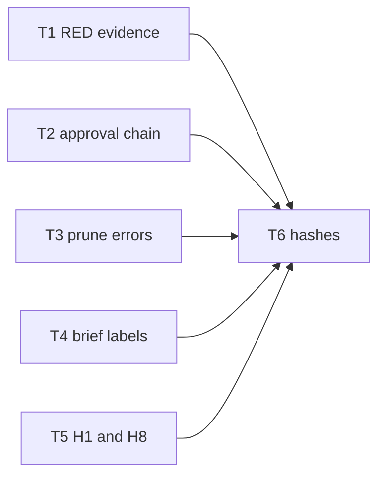

# Fix Findings From Dispatch Diagnostics Reports

> **TL;DR:** Remove the verified Dispatch defects behind nine diagnostics findings: false `missing-red` re-raises, the approval revert cycle, collapsed prune errors, unlabeled brief hashes and inaccurate H1/H8 diagnostics.
>
> **Parent:** `.scratch/dispatch-skills/20261027T2359Z-plan-fixes-for-findings-in-dispatch-diag/diagnostics-findings.spec.md` · sha256:fa07a7ef5c1c65ebb695481fe09d5d5039325173dc903b1260cc246567b3e23e
>
> **Decide:** none
>
> **Risk:** med — the approval gate and review tool-finding loop change; both have broad callers
>
> **Scope:** skills/dispatch/scripts/toolkit, skills/dispatch/references, tests

## At a Glance
- **What:** Dispatch stops raising settled RED gaps, accepts approvals that a recorded edit chain explains, keeps real prune I/O errors, labels governed hashes for writers and names the exhausted model in quota diagnostics.
- **How it works:** Each fix reads a record the toolkit already owns: RED capture exit files, ruling records, ledger edit records and invocation routing facts.

Text summary: five independent fixes, then one hash regeneration.

## Background
- `redGaps` (`skills/dispatch/scripts/toolkit/red.ts:3`) takes the writer report text only. `review.ts:271-301` builds `missing-red` findings after `finalizeRound`, marks a repeat `unresolved` and opens `missing-red:<review>:<task>:<SC>:R<n>:g<gen>` escalations when the target moved. It never reads rulings. `rulingRows()` (`review.ts:183`) returns this review's ruling records; subjects are `review:<review>:<finding id>`.
- The brief tool sets the RED log directory to `<session>/.state/briefs/<task>-<launch>.red` (`brief.ts:112`). The capture wrapper writes `<SC>.exit` as `{"status":<int|null>,"signal":…,"error":…}` (`brief.ts:41`). The review loop already resolves `<task>-<launch>.report.md` in the same directory (`review.ts:275`).
- `append` (`ledger.ts:120-124`) requires approval data to equal `currentHashes`. `gate` (`ledger.ts:187-208`) walks only edits with `seq > approval.seq`.
- `prune.ts:120`, `:123`, `:143` use bare `catch` that maps every error to `prune-review-required`.
- Writer brief template lines 5 and 7 and `brief.ts:124` print bare hashes.
- `heuristics` (`domain/diagnostics.ts:318-336`) H1 tallies `provider` only; `FAILURE_FIXES.quota` says "add another model alias". H8 (`:376`) always cites `scripts/toolkit/records.ts`. `InvocationFacts` carries `model` and `routingOutcome`.

## Key Interfaces & Data
- `redGaps(input: {plan; task; changed; report?; redExits?: ReadonlyMap<string, number | null>})` — `redExits` maps criterion ID to the parsed wrapper `status`; a non-zero integer satisfies the criterion.
- Approval baselines, shared by `append` and `gate`, per bound artifact. Pre-approval edits are that artifact's `edit` records with `seq < approval.seq` (every record, at append time).
  - Baseline 1 is always the approved hash.
  - Baseline 2 exists only when a valid chain exists: select the latest pre-approval edit whose `before` equals the approved hash; it and every later pre-approval edit chain contiguously (`before` equals the previous `after`) and are all `non-intent`. Baseline 2 is the last `after`. An invalid or absent chain yields no baseline 2; it never fails on its own.
  - Append accepts when the current hash equals baseline 1 or baseline 2; otherwise `approval-stale` lists current hashes. Exact-current approval therefore stays valid after any history, including an unrecorded change after a recorded edit.
  - Gate applies post-approval edits from each baseline with today's strict rules and allows when either baseline reaches the current hash; when both fail it reports the baseline-1 reason.

## Key Decisions & Context
- Spec DEC-1: approval accepts a recorded non-intent chain; the stale message lists current hashes.
- Spec DEC-2: wrapper exit files plus `rejected` ruling carry-forward; no prose parsing.
- Spec DEC-3: H1 keeps quota findings and adds model and recovery detail.
- Spec DEC-4: no H3 change.
- Carry-forward matches prior findings by defect prefix `missing-red: <task> <SC>;`, the same key `review.ts:285` uses.

## Constraints
- Preserve existing error reasons and exit codes; only messages and accepted inputs change.
- Keep `rejected`-only carry-forward; `duplicate` and `deferred` rulings do not suppress.
- Every test stays in memory or in the existing isolated-temp fixtures; Git flows stay in `tests/e2e/`.

## Open Questions & Assumptions
- (assumption) A chain edit recorded before approval with `before` unequal to the walk hash belongs to unrelated history and is skipped.

## Out of Scope
- User provider config, quota cooldown and H3.
- Follow-up: in session 0201Z the T1 writer launched on the reverted plan before the edit was re-applied (seq 12-13); REQ-3 removes the cause, so no further change.

## Task Map

| ID | Title | Outcome | Prerequisites | Criteria |
| --- | --- | --- | --- | --- |
| T1 | Settled RED evidence | Review accepts wrapper RED exits and stops re-raising rejected `missing-red` gaps | none | SC1, SC2 |
| T2 | Approval edit chain | Approval append and gate accept recorded non-intent chains; stale message lists current hashes | none | SC3 |
| T3 | Prune error causes | Prune maps only absent or malformed review artifacts to `prune-review-required` | none | SC4 |
| T4 | Governed hash labels | Writer briefs label governed hashes and point to `lint run` | none | SC5 |
| T5 | Accurate H1 and H8 | H1 quota names provider/model and recoveries; H8 cites the throwing module | none | SC6 |
| T6 | Skill hashes | `skill-hashes.json` matches changed hash-tracked files | T1, T2, T3, T4, T5 | SC7 |

## Proposed Changes

### T1 — Settled RED evidence
- A criterion whose wrapper `.exit` shows a non-zero status has RED evidence, even when the writer report lacks the section.
- Within one review, a `rejected` ruling on any earlier `missing-red` finding for the same task and criterion suppresses the finding and its escalation in later rounds.

- #### [MODIFY] skills/dispatch/scripts/toolkit/red.ts
  - Changes: Add optional `redExits` to `redGaps` input; drop a gap when `redExits.get(c.id)` is a non-zero integer.
  - Invariants: Without `redExits`, output is unchanged; the eligibility filter stays aligned with `renderRedCapture`.

- #### [MODIFY] skills/dispatch/scripts/toolkit/review.ts
  - Changes: In the tool-finding loop, read `<task>-<launch>.red/<SC>.exit` for each red criterion (JSON; ignore `ENOENT` and parse errors) and pass `redExits`. Before pushing a gap, look up prior findings with the same defect prefix; when any has a `rejected` ruling in `rulingRows()`, skip the finding, cluster entry and escalation.
  - Invariants: Unruled repeats keep `unresolved` and escalation behavior; other read errors propagate.

- #### [MODIFY] tests/unit/toolkit/red.test.ts
  - Changes: Add test `red gaps accept a non-zero wrapper exit and ignore zero, null or absent exits`.

- #### [MODIFY] tests/e2e/toolkit-review.test.ts
  - Changes: Add test `rejected missing-red ruling settles later rounds after the target moves`: round 1 gap, append `rejected` ruling, move target, round 2 has no `missing-red` finding or escalation. Add test `wrapper RED exit suppresses missing-red without a report section`.

### T2 — Approval edit chain
- Appending an approval for the user-seen hashes succeeds when recorded non-intent edits lead to the current hashes; the gate accepts the same chain.
- A stale approval error lists the current hash per artifact.

- #### [MODIFY] skills/dispatch/scripts/toolkit/ledger.ts
  - Changes: Extract the chain walk from `gate` into one local helper used by `append` (approval branch) and `gate`, per Key Interfaces. Extend the `approval-stale` message with `current: <artifact> <hash>` for each bound artifact.
  - Invariants: `missing-approval`, `unrecorded-change` and `intent-change` reasons keep their triggers for post-approval edits; approval still requires a bind.

- #### [MODIFY] skills/dispatch/references/toolkit.md
  - Changes: In `### approval`, state that the tuple may precede recorded non-intent edits that reach the current hashes.

- #### [MODIFY] tests/unit/toolkit/ledger-bindings.test.ts
  - Changes: Add test `approval accepts a recorded non-intent chain and stale approvals list current hashes`: edit `A→B` then approval `A` succeeds and `gate` allows; intent edit `A→B` then revert `B→A` then approval `A` succeeds; recorded `A→B`, unrecorded change to `C`, then approval `C` succeeds and `gate` allows; a post-approval non-intent edit from baseline 2 is allowed and an unrecorded post-approval change is refused; non-intent chain `A→B→C` after an earlier `C→A` history selects the latest `A→B`; intent-class chain and broken chain fail `approval-stale` with `current:` in the message.

### T3 — Prune error causes
- Absent or malformed review artifacts still refuse pruning; any other read failure surfaces its real error.

- #### [MODIFY] skills/dispatch/scripts/toolkit/prune.ts
  - Changes: At the round directory read, the round/findings read and the slot read, refuse `prune-review-required` only for `ENOENT` or `SyntaxError`; rethrow others.
  - Invariants: `rejections()` behavior is unchanged.

- #### [MODIFY] tests/unit/toolkit/prune.test.ts
  - Changes: Add test `prune review identity keeps unexpected read errors`: an injected `EACCES` from a review artifact read propagates; a missing round directory still refuses.

### T4 — Governed hash labels
- Writers see `governed hash sha256:…` and an instruction to compare with `lint run`, not raw file SHA-256.

- #### [MODIFY] skills/dispatch/references/templates/writer-brief.md
  - Changes: Lines 5 and 7 read `(governed hash {{specHash}})` and `(governed hash {{planHash}})`; add one sentence: governed hashes come from `lint run` and differ from raw file SHA-256.

- #### [MODIFY] skills/dispatch/scripts/toolkit/brief.ts
  - Changes: The design line uses `(governed hash <hash>)`.

- #### [MODIFY] tests/unit/toolkit/brief.test.ts
  - Changes: Add test `brief labels governed hashes and names lint for comparison`.

### T5 — Accurate H1 and H8
- H1 quota evidence shows `provider/model ×n` and `<k> recovered by fallback`, counting only failures whose slot later completed; the fix tells the user to reorder or remove the exhausted alias or check its quota.
- H8 cites `scripts/toolkit/ledger.ts` for `approval-stale` and `key-conflict`.

- #### [MODIFY] skills/dispatch/scripts/toolkit/domain/diagnostics.ts
  - Changes: For H1, tally `provider/model` and append `, <k> recovered by fallback` where `k` counts failed items whose `routingOutcome` is `next-model`, `next-mode` or `reserve` and for which an invocation with the same `subject` succeeded (outcome `ok`, no failed validation) either in the same physical `slot` with a higher `attempt`, or in a reserve slot whose `targetSlot` names the failed slot. The reserve link recovers every preceding `next-model`, `next-mode` or `reserve` failure of that target slot. Compare attempts only within one physical slot. Absent routing, `stop`, `native-fallback` (completion is not in invocation facts) and failed or pending fallback count as unrecovered. Replace `FAILURE_FIXES.quota` text. Select the H8 component per rejection class.
  - Invariants: H1 trigger thresholds and other classes' text are unchanged.

- #### [MODIFY] tests/unit/toolkit/domain/report.test.ts
  - Changes: Update the quota assertion at line 361 to the new fix text; add test `H1 quota names model and fallback recoveries and H8 cites the rejecting module`, with a successful reserve case (linked by `targetSlot`), a case with two target quota failures (`next-model`, then `reserve`) followed by reserve success that expects 2 recovered, and negative cases: failed fallback, absent routing outcome and native fallback do not count as recovered.

### T6 — Skill hashes
- The hash manifest matches every changed hash-tracked skill file.

- #### [GENERATED] skills/dispatch/skill-hashes.json
  - Command: `npm run hashes`
  - Inputs: skills/dispatch/scripts/toolkit/red.ts, skills/dispatch/scripts/toolkit/review.ts, skills/dispatch/scripts/toolkit/ledger.ts, skills/dispatch/scripts/toolkit/prune.ts, skills/dispatch/scripts/toolkit/brief.ts, skills/dispatch/scripts/toolkit/domain/diagnostics.ts, skills/dispatch/references/toolkit.md, skills/dispatch/references/templates/writer-brief.md

## Success Criteria
- [SC1] `redGaps` drops a criterion with a non-zero wrapper exit and keeps it for zero, null or absent exits.
  

  - Satisfies: REQ-1
  - Changes: skills/dispatch/scripts/toolkit/red.ts, skills/dispatch/scripts/toolkit/review.ts, tests/unit/toolkit/red.test.ts
  - Tests: tests/unit/toolkit/red.test.ts
  - Verify: `node --test --import=./tests/helpers/isolated-temp.ts --import=./tests/helpers/block-spawn.ts --test-reporter=./scripts/test-reporter.ts --test-name-pattern="non-zero wrapper exit" tests/unit/toolkit/red.test.ts`
  - RED: `node --test --import=./tests/helpers/isolated-temp.ts --import=./tests/helpers/block-spawn.ts --test-reporter=./scripts/test-reporter.ts --test-name-pattern="non-zero wrapper exit" {files}`
  - Evidence: red
  - Retain: durable
  - Test rationale: One unit test owns the exit-status boundary (non-zero, zero, null, absent) that the review loop relies on.

  

- [SC2] Code review emits no `missing-red` finding or escalation after a `rejected` ruling or with a wrapper RED exit.
  

  - Satisfies: REQ-1, REQ-2
  - Changes: skills/dispatch/scripts/toolkit/review.ts, tests/e2e/toolkit-review.test.ts
  - Tests: tests/e2e/toolkit-review.test.ts
  - Verify: `node --test --import=./tests/helpers/isolated-temp.ts --import=./tests/helpers/block-spawn.ts --test-reporter=./scripts/test-reporter.ts --test-name-pattern="missing-red" tests/e2e/toolkit-review.test.ts`
  - RED: `node --test --import=./tests/helpers/isolated-temp.ts --import=./tests/helpers/block-spawn.ts --test-reporter=./scripts/test-reporter.ts --test-name-pattern="rejected missing-red ruling|wrapper RED exit" {files}`
  - Evidence: red
  - Retain: durable
  - Test rationale: The review loop joins Git targets, ledger rulings and RED files; only the e2e repo fixture exercises a moved target. Existing missing-red tests guard the unruled path.

  

- [SC3] Approval append and gate accept a recorded non-intent chain; broken or intent chains fail `approval-stale` with current hashes.
  

  - Satisfies: REQ-3
  - Changes: skills/dispatch/scripts/toolkit/ledger.ts, skills/dispatch/references/toolkit.md, tests/unit/toolkit/ledger-bindings.test.ts
  - Tests: tests/unit/toolkit/ledger-bindings.test.ts
  - Verify: `node --test --import=./tests/helpers/isolated-temp.ts --import=./tests/helpers/block-spawn.ts --test-reporter=./scripts/test-reporter.ts --test-name-pattern="recorded non-intent chain" tests/unit/toolkit/ledger-bindings.test.ts`
  - RED: `node --test --import=./tests/helpers/isolated-temp.ts --import=./tests/helpers/block-spawn.ts --test-reporter=./scripts/test-reporter.ts --test-name-pattern="recorded non-intent chain" {files}`
  - Evidence: red
  - Retain: durable
  - Test rationale: The approval gate is a user-intent boundary; one test covers accept, intent-chain and broken-chain outcomes plus the message.

  

- [SC4] Prune keeps unexpected read errors and still refuses missing review artifacts.
  

  - Satisfies: REQ-4
  - Changes: skills/dispatch/scripts/toolkit/prune.ts, tests/unit/toolkit/prune.test.ts
  - Tests: tests/unit/toolkit/prune.test.ts
  - Verify: `node --test --import=./tests/helpers/isolated-temp.ts --import=./tests/helpers/block-spawn.ts --test-reporter=./scripts/test-reporter.ts --test-name-pattern="unexpected read errors" tests/unit/toolkit/prune.test.ts`
  - RED: `node --test --import=./tests/helpers/isolated-temp.ts --import=./tests/helpers/block-spawn.ts --test-reporter=./scripts/test-reporter.ts --test-name-pattern="unexpected read errors" {files}`
  - Evidence: red
  - Retain: durable
  - Test rationale: Guards the operator-visible error cause that the retro reported lost.

  

- [SC5] Rendered writer briefs label each hash `governed hash` and name `lint run`.
  

  - Satisfies: REQ-5
  - Changes: skills/dispatch/references/templates/writer-brief.md, skills/dispatch/scripts/toolkit/brief.ts, tests/unit/toolkit/brief.test.ts
  - Tests: tests/unit/toolkit/brief.test.ts
  - Verify: `node --test --import=./tests/helpers/isolated-temp.ts --import=./tests/helpers/block-spawn.ts --test-reporter=./scripts/test-reporter.ts --test-name-pattern="labels governed hashes" tests/unit/toolkit/brief.test.ts`
  - RED: `node --test --import=./tests/helpers/isolated-temp.ts --import=./tests/helpers/block-spawn.ts --test-reporter=./scripts/test-reporter.ts --test-name-pattern="labels governed hashes" {files}`
  - Evidence: red
  - Retain: durable
  - Test rationale: Locks the writer-facing label that prevented false mismatch reports.

  

- [SC6] H1 quota evidence names `provider/model` and recoveries with the new fix text; H8 cites `ledger.ts` for `approval-stale` and `key-conflict`.
  

  - Satisfies: REQ-6, REQ-7
  - Changes: skills/dispatch/scripts/toolkit/domain/diagnostics.ts, tests/unit/toolkit/domain/report.test.ts
  - Tests: tests/unit/toolkit/domain/report.test.ts
  - Verify: `node --test --import=./tests/helpers/isolated-temp.ts --import=./tests/helpers/block-spawn.ts --test-reporter=./scripts/test-reporter.ts --test-name-pattern="fallback recoveries" tests/unit/toolkit/domain/report.test.ts`
  - RED: `node --test --import=./tests/helpers/isolated-temp.ts --import=./tests/helpers/block-spawn.ts --test-reporter=./scripts/test-reporter.ts --test-name-pattern="fallback recoveries" {files}`
  - Evidence: red
  - Retain: durable
  - Test rationale: One heuristic test covers the user-facing evidence and component text for both heuristics.

  

- [SC7] Hash manifest and full gates pass on the integrated tree.
  

  - Satisfies: REQ-1, REQ-2, REQ-3, REQ-4, REQ-5, REQ-6, REQ-7
  - Changes: skills/dispatch/skill-hashes.json
  - Verify: `npm run test:all` [FINAL]
  - Evidence: verify

  

## Verification Plan
- Seams: tests/unit/toolkit/red.test.ts, tests/e2e/toolkit-review.test.ts, tests/unit/toolkit/ledger-bindings.test.ts, tests/unit/toolkit/prune.test.ts, tests/unit/toolkit/brief.test.ts, tests/unit/toolkit/domain/report.test.ts
### Automated Tests
- `node --test --import=./tests/helpers/isolated-temp.ts --import=./tests/helpers/block-spawn.ts --test-reporter=./scripts/test-reporter.ts tests/unit/toolkit/red.test.ts tests/unit/toolkit/review.test.ts tests/unit/toolkit/ledger-bindings.test.ts tests/unit/toolkit/ledger-validation.test.ts tests/unit/toolkit/prune.test.ts tests/unit/toolkit/brief.test.ts tests/unit/toolkit/domain/report.test.ts tests/unit/toolkit/cli.test.ts`
- `node --test --import=./tests/helpers/isolated-temp.ts --import=./tests/helpers/block-spawn.ts --test-reporter=./scripts/test-reporter.ts tests/e2e/toolkit-review.test.ts`
### Manual Verification
- Replay finding 1: in a scratch copy of session 1025Z data, confirm `redGaps` with the T1 `.red` directory still flags SC1 (non-JSON `exit=1`) and that the R1 `rejected` ruling now suppresses R2/R3.

## Rollback & Blast Radius
- `gate` callers: `brief render`, `worktree integrate`, `review run` level gate path. Reverting `ledger.ts` restores strict approval equality.
- `redGaps` callers: `review.ts` only. Revert T1 to restore prior re-raise behavior.

## Review Findings & Resolutions

| Review | ID | Round | Severity | Status | Ruling |
| --- | --- | --- | --- | --- | --- |
| plan-diagnostics-findings.plan | R1-F001 | 1 | MUST | Accepted | Valid: walk could consume intent history before an exact-current approval. Plan… |
| plan-diagnostics-findings.plan | R1-F002 | 1 | SHOULD | Accepted | Valid: routing is recorded before the next attempt runs. Recovery now requires … |
| plan-diagnostics-findings.plan | R2-F001 | 2 | MUST | Accepted | Valid: E-based exact match rejected approval of an unrecorded current change. R… |
| plan-diagnostics-findings.plan | R2-F002 | 2 | SHOULD | Accepted | Valid: reserve runs in its own physical slot linked by targetSlot. Recovery now… |
| plan-diagnostics-findings.plan | R3-F001 | 3 | SHOULD | Accepted | Valid: a successful reserve linked by targetSlot recovers all preceding next-mo… |

- Round 1 (plan-diagnostics-findings.plan): 2 findings — [findings](.state/reviews/plan-diagnostics-findings.plan/round-1/findings.json)

- Round 2 (plan-diagnostics-findings.plan): 2 findings — [findings](.state/reviews/plan-diagnostics-findings.plan/round-2/findings.json)

- Round 3 (plan-diagnostics-findings.plan): 1 findings — [findings](.state/reviews/plan-diagnostics-findings.plan/round-3/findings.json)

