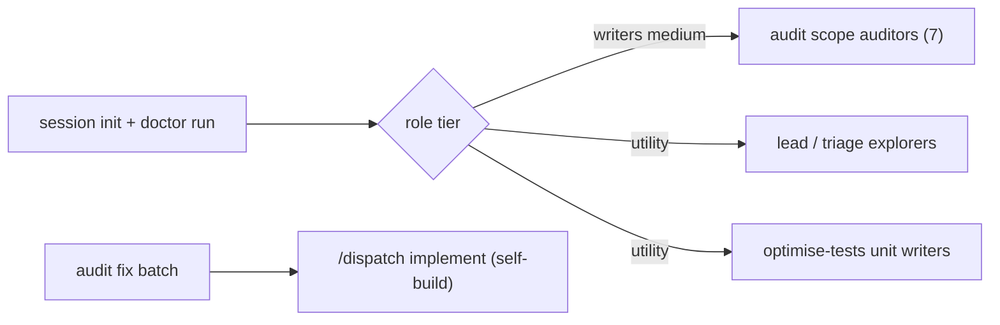

# Align Dispatch support skills with current Dispatch

> **Parent:** `.scratch/dispatch-skills/20261105T0027Z-update-audit-dispatch-skills-audit-dispa/support-skills.spec.md` · sha256:21cbd8a70942f92544ea6bc2a6d0f5960352fbd234ab079b767bb9a7cd270f62
>
> **Decide:** approve plan and run level
>
> **Risk:** med — maintainer-only skills, but audit scope and calibration changes touch pinned tooling tests
>
> **Scope:** `.agents/skills/audit-dispatch-skills`, `.agents/skills/audit-dispatch-skills-fix`, `.agents/skills/optimise-tests`, `tests/tooling`

## At a Glance
- **What:** Bring the three maintainer support skills up to current Dispatch, add an authoring-quality audit scope, and launch their subagents on Dispatch-configured models.
- **How it works:** Skills read `doctor run` from a Dispatch session for models; the audit gains an `authoring` scope, brief and calibration case; the fix skill delivers batches through `/dispatch implement` under self-build.



Text summary: one doctor read assigns every subagent role its configured tier; fix batches run through Dispatch implement.

## Background
- Auditors and optimise writers launch as `general-purpose` with no model: `.agents/skills/audit-dispatch-skills/SKILL.md` host table and step 4; `.agents/skills/optimise-tests/SKILL.md` host table and step 2.
- `scripts/scenarios.ts` `SCOPE_CLASSES` holds five verb scopes plus `shared`; `buildPackets` maps `shared` to `references/shared.md` and every other scope to `references/walkthrough.md`. `validateCatalog` rejects entries with line pointers or missing files.
- `scripts/calibrate.ts` pins `DEFECT_CATEGORIES` (ambiguity, handoff, efficiency, recovery), `CONTROLS = 2` and `MIN_RECOVERED = 3`; `validateFixture` requires full commit and blob hashes and matching excerpt sha256 per case.
- `audit-dispatch-skills-fix/scripts/status.mjs` `PHASES` are `planned`, `plan-reviewed`, `implemented`, `code-reviewed`; checkpoints verify only that linked evidence files exist.

## Key Interfaces & Data
`doctor run` result file (read the `path`, not the 1024-byte stdout summary):

```json
{ "ok": true, "config": { "problems": [] },
  "writers": { "claude": { "models": ["claude-sonnet-5-5"], "effort": "medium" } },
  "utility": { "claude": { "models": ["claude-haiku-5-5"], "effort": "medium" } } }
```

Keys are canonical platforms `claude`, `agy`, `copilot`, `opencode`, `codex`. `models` lists alternatives ("model X or Y", as Dispatch writer briefs phrase it).

## Key Decisions & Context
- Model source, tiers, fix path, authoring scope and scenario placement follow spec DEC-1 to DEC-5.
- Each skill resolves models once per run: `node <skills-dir>/dispatch/scripts/dispatch.ts session init --objective "<skill> <run>" --host <platform>`, then `doctor run --session <session> --level medium`. Stop and report when `ok` is false or the role's entry is absent and the host has native subagents; work inline only when no entry resolves, as Dispatch routing does.
- Launch a role on the first listed model the host accepts, with the listed effort; record the resolved model and effort beside each launch handle in the run manifest or ledger the skill already keeps.
- The authoring scope gets its own brief (`references/authoring.md`) and three mandatory classes: `contradiction`, `rule-home`, `disclosure-flow`. Each class has a catalog scenario whose `entries` name the prose files to sweep, so findings keep the Scenario-id rule.
- Calibration adds category `contradiction` (five defects) and one authoring control (three controls); `MIN_RECOVERED` becomes 4 (four of five), keeping the existing ~75% bar.

## Constraints
- Edit only maintainer skill files and their tooling tests; no change to `skills/dispatch/**`, `scripts/**` or vendored skills.
- Keep subagent write limits: auditors and explorers write only assigned findings or map files; utility writers edit only assigned paths and run no Git write commands.
- Link Dispatch rules (routing, self-build, implement) instead of restating them; follow `.agents/skills/writing-for-agents/SKILL.md`.
- Writers locate code symbols with `codegraph explore "<symbols>"` when the CLI exists; it is not installed here, so use text search.

## Open Questions & Assumptions
- (assumption) Model resolution stays in skill prose, not a new script, because it is two CLI calls and a JSON read.
- (assumption) The new calibration defect is a real historical duplicate-rule or contradiction fix reachable in this clone (candidates: commits `a1d668b`, `8c9729a`); its excerpts pin that commit's parent.
- (assumption) Copilot rows follow the same rule as other hosts: inline only when no entry resolves or the host has no native subagents, recorded as a coverage gap.

## Out of Scope
- Provider probe behavior and its Dispatch library imports.
- Hash or term-check coverage of `.agents/` (adjacent finding, reported in handoff).
- Running a live audit, calibration or optimise-tests pass.

## Task Map

| ID | Title | Outcome | Prerequisites | Criteria |
| --- | --- | --- | --- | --- |
| T1 | Configured subagent launches | Audit and optimise-tests launch roles on doctor-resolved tiers | none | SC1, SC2 |
| T2 | Authoring audit scope | Audit selects and briefs a seventh `authoring` scope | T1 | SC3 |
| T3 | Contradiction calibration case | Calibration corpus and scorer include a contradiction defect and authoring control | T2 | SC4 |
| T4 | Current Dispatch scenarios and names | Catalog covers spec stage and routing; no stale Dispatch names remain | T2 | SC5 |
| T5 | Fix skill on Dispatch implement | Fix batches run through `/dispatch implement` under self-build with explorer triage | T4 | SC6 |

## Proposed Changes

### T1 — Configured subagent launches
- Replace host-table `general-purpose`/no-model launches with a "Subagent models" step that runs `session init` and `doctor run`, then names the doctor field per role.
- Audit: scope auditors use `writers` at `medium`; lead verification in step 5 sends multi-file reading to `utility` explorers that return cited claims; the lead keeps rulings.
- optimise-tests: unit writers use `utility`; writer brief keeps its scope and no-Git-write limits.

<details>

- #### [MODIFY] .agents/skills/audit-dispatch-skills/SKILL.md
  - Changes: host table drops per-host agent-type launch text for a tier column; new model-resolution step before step 4; step 4 brief and step 5 verification name tiers; blocker and inline rules link `skills/dispatch/SKILL.md#routing`.
  - Invariants: step numbering, `Done when` criteria, budgets and containment unchanged.
- #### [MODIFY] .agents/skills/optimise-tests/SKILL.md
  - Changes: host table and step 2 launch on `utility`; same resolution step.
  - Invariants: ownership, ledger and gate rules unchanged.

</details>

### T2 — Authoring audit scope
- `authoring` scope traces three catalog scenarios (contradiction, rule-home, disclosure-flow) across agent-facing prose: `skills/dispatch/**`, `AGENTS.md` and the support skills.
- Contradictions and duplicate rule homes are defects citing both locations; disclosure and flow improvements are opportunities.

<details>

- #### [NEW] .agents/skills/audit-dispatch-skills/references/authoring.md
  - Purpose: scope brief: axes (contradiction, rule-home, writing-for-agents conformance, progressive disclosure, streamlined flow), sweep method per scenario, both-location evidence rule, defect vs opportunity split; reuses findings.md format and walkthrough budgets.
  - Reuse: `references/shared.md` and `references/walkthrough.md` are verb- and boundary-specific; none fits a prose sweep.
- #### [MODIFY] .agents/skills/audit-dispatch-skills/scripts/scenarios.ts
  - Changes: `SCOPE_CLASSES.authoring = ['contradiction', 'rule-home', 'disclosure-flow']`; `buildPackets` maps `authoring` to `references/authoring.md`; header comment names seven scopes.
- #### [MODIFY] .agents/skills/audit-dispatch-skills/references/scenarios.json
  - Changes: three `authoring` scenarios, one per class, with file entries only.
- #### [MODIFY] .agents/skills/audit-dispatch-skills/config.json
  - Changes: `limits.scopes` 7.
- #### [MODIFY] .agents/skills/audit-dispatch-skills/SKILL.md
  - Changes: intro counts seven scope auditors and names the authoring scope.
- #### [MODIFY] tests/tooling/audit-scenarios.test.ts
  - Changes: default selection and packet count include `authoring` with its brief reference.
- #### [MODIFY] tests/tooling/audit-state.test.ts
  - Changes: `limits.scopes` expectation 7.

</details>

### T3 — Contradiction calibration case
- Corpus gains one real historical contradiction or duplicate-rule defect and one authoring control; scorer requires four of five recovered defects.

<details>

- #### [MODIFY] .agents/skills/audit-dispatch-skills/scripts/calibrate.ts
  - Changes: `DEFECT_CATEGORIES` adds `contradiction`; `CONTROLS` 3; `MIN_RECOVERED` 4.
- #### [MODIFY] .agents/skills/audit-dispatch-skills/fixtures/calibration/cases.json
  - Changes: add `defect-*` case (category `contradiction`) and `control-*` case with commit, parent, blob, line ranges and excerpt sha256 from `git show`.
  - Invariants: existing six cases unchanged; excerpts verbatim from the pinned blob.
- #### [MODIFY] .agents/skills/audit-dispatch-skills/references/calibration.md
  - Changes: pass rule reads four of five defects and all eight cases.
- #### [MODIFY] tests/tooling/audit-calibration.test.ts
  - Changes: corpus-shape and pass-threshold expectations.
- #### [MODIFY] tests/tooling/audit-calibration-scoring.test.ts
  - Changes: threshold boundary uses four of five.
- #### [MODIFY] tests/tooling/audit-calibration-claims.test.ts
  - Changes: case-count expectations when pinned.
- #### [MODIFY] tests/helpers/audit-calibration.ts
  - Changes: fixture builders produce five categories and three controls.

</details>

### T4 — Current Dispatch scenarios and names
- Catalog adds a `plan` `decision` scenario covering spec stage (grounding, critique, grilling, confirm) and an `implement` `normal` scenario covering explorer/utility routing and test cleanup.
- Stale names replaced: `dispatch.ts start`/`send` become "running Dispatch session or toolkit actions"; absent example paths use current files.

<details>

- #### [MODIFY] .agents/skills/audit-dispatch-skills/references/scenarios.json
  - Changes: two scenarios with entries `skills/dispatch/references/spec-stage.md`, `skills/dispatch/references/grounding.md`, `skills/dispatch/SKILL.md`, `skills/dispatch/references/verbs/implement.md`.
- #### [MODIFY] .agents/skills/audit-dispatch-skills/references/walkthrough.md
  - Changes: static-only constraint names current entry actions.
- #### [MODIFY] .agents/skills/audit-dispatch-skills-fix/references/triage-and-state.md
  - Changes: example `affectedPaths` names a file present at HEAD.
- #### [MODIFY] .agents/skills/optimise-tests/references/criteria.md
  - Changes: example records name a test file present at HEAD.

</details>

### T5 — Fix skill on Dispatch implement
- Constraints: follows T4 because both edit `triage-and-state.md`.
- Step 4–5 become one Dispatch run: `/dispatch <level> implement:` with batch context under `skills/dispatch/references/self-build.md`; plan, plan review, implementation and code review evidence map to the four existing checkpoints.
- Step 2 triage sends multi-file source reading to `utility` explorers resolved as in T1; the lead keeps rulings.

<details>

- #### [MODIFY] .agents/skills/audit-dispatch-skills-fix/SKILL.md
  - Changes: delete the Dispatch-implement ban; rewrite steps 4–5; add model-resolution line for triage explorers; resume rule follows Dispatch `status show`.
  - Invariants: report-owned state, selection rules and `fixed` preconditions unchanged.
- #### [MODIFY] .agents/skills/audit-dispatch-skills-fix/references/triage-and-state.md
  - Changes: checkpoint evidence names Dispatch artifacts (plan, review results, walkthrough).
  - Invariants: `progress` and `triage` JSON schemas unchanged.

</details>

## Success Criteria
- [SC1] Audit and optimise-tests name `session init`, `doctor run` and a doctor tier for every subagent role, with no host-default launch left.
  <details>

  - Satisfies: REQ-1, REQ-2
  - Changes: .agents/skills/audit-dispatch-skills/SKILL.md, .agents/skills/optimise-tests/SKILL.md
  - Evidence: review
  - Review: artifact: both SKILL.md files; scenario: read each launch site; pass: every launch names `writers` medium or `utility`, the blocker and inline rules link Dispatch routing, and no `general-purpose` launch without a model remains.

  </details>
- [SC2] No support skill script reads Dispatch config model fields for subagent launch.
  <details>

  - Satisfies: REQ-1
  - Changes: .agents/skills/audit-dispatch-skills/SKILL.md
  - Evidence: review
  - Review: artifact: `.agents/skills/*/scripts/`; scenario: search for `write-subagents`, `explore-subagents` and `config.local`; pass: no hit outside the unchanged provider probe.

  </details>
- [SC3] The audit selects an `authoring` scope with three classes and packets pointing at its brief.
  <details>

  - Satisfies: REQ-3
  - Changes: .agents/skills/audit-dispatch-skills/scripts/scenarios.ts, .agents/skills/audit-dispatch-skills/references/scenarios.json, .agents/skills/audit-dispatch-skills/references/authoring.md, .agents/skills/audit-dispatch-skills/config.json, tests/tooling/audit-scenarios.test.ts, tests/tooling/audit-state.test.ts
  - Tests: tests/tooling/audit-scenarios.test.ts, tests/tooling/audit-state.test.ts
  - Verify: `node --test --import=./tests/helpers/isolated-temp.ts --import=./tests/helpers/block-spawn.ts --test-reporter=./scripts/test-reporter.ts tests/tooling/audit-scenarios.test.ts tests/tooling/audit-state.test.ts`
  - RED: `node --test --import=./tests/helpers/isolated-temp.ts --import=./tests/helpers/block-spawn.ts --test-reporter=./scripts/test-reporter.ts tests/tooling/audit-scenarios.test.ts`
  - Evidence: red

  </details>
- [SC4] Calibration validates five defect categories including `contradiction` and three controls, and passes at four recovered defects.
  <details>

  - Satisfies: REQ-3
  - Changes: .agents/skills/audit-dispatch-skills/scripts/calibrate.ts, .agents/skills/audit-dispatch-skills/fixtures/calibration/cases.json, .agents/skills/audit-dispatch-skills/references/calibration.md, tests/tooling/audit-calibration.test.ts, tests/tooling/audit-calibration-scoring.test.ts, tests/tooling/audit-calibration-claims.test.ts, tests/helpers/audit-calibration.ts
  - Tests: tests/tooling/audit-calibration.test.ts, tests/tooling/audit-calibration-scoring.test.ts, tests/tooling/audit-calibration-claims.test.ts, tests/helpers/audit-calibration.ts
  - Verify: `node --test --import=./tests/helpers/isolated-temp.ts --import=./tests/helpers/block-spawn.ts --test-reporter=./scripts/test-reporter.ts tests/tooling/audit-calibration.test.ts tests/tooling/audit-calibration-scoring.test.ts tests/tooling/audit-calibration-claims.test.ts`
  - RED: `node --test --import=./tests/helpers/isolated-temp.ts --import=./tests/helpers/block-spawn.ts --test-reporter=./scripts/test-reporter.ts tests/tooling/audit-calibration.test.ts`
  - Evidence: red

  </details>
- [SC5] The catalog covers spec stage and routing, and no support skill instruction names an absent Dispatch command, file or anchor.
  <details>

  - Satisfies: REQ-4
  - Changes: .agents/skills/audit-dispatch-skills/references/scenarios.json, .agents/skills/audit-dispatch-skills/references/walkthrough.md, .agents/skills/audit-dispatch-skills-fix/references/triage-and-state.md, .agents/skills/optimise-tests/references/criteria.md
  - Verify: `node --test --import=./tests/helpers/isolated-temp.ts --import=./tests/helpers/block-spawn.ts --test-reporter=./scripts/test-reporter.ts tests/tooling/audit-scenarios.test.ts`
  - Evidence: review
  - Review: artifact: the three skills' `SKILL.md` and `references/*.md`; scenario: check every named Dispatch path, anchor and command against HEAD; pass: all resolve, calibration fixture excerpts excepted.

  </details>
- [SC6] The fix skill runs each batch through `/dispatch implement` under self-build and maps its checkpoints to Dispatch evidence.
  <details>

  - Satisfies: REQ-5, REQ-2
  - Changes: .agents/skills/audit-dispatch-skills-fix/SKILL.md, .agents/skills/audit-dispatch-skills-fix/references/triage-and-state.md
  - Verify: `node --test --import=./tests/helpers/isolated-temp.ts --import=./tests/helpers/block-spawn.ts --test-reporter=./scripts/test-reporter.ts tests/tooling/audit-report-progress.test.ts`
  - Evidence: review
  - Review: artifact: fix `SKILL.md`; scenario: follow one batch from triage to `fixed`; pass: no Dispatch-implement ban, self-build linked, each of the four checkpoints names its Dispatch evidence, triage explorers named with tier.

  </details>
- [SC7] The full suite and e2e suite pass after the last change.
  <details>

  - Satisfies: REQ-6
  - Changes: .agents/skills/audit-dispatch-skills/scripts/scenarios.ts, .agents/skills/audit-dispatch-skills/scripts/calibrate.ts
  - Verify: `npm run test:all`
  - Evidence: verify
  - Integration: suite gate spans T2–T4 script changes.

  </details>

## Verification Plan
- Seams: tests/tooling/audit-scenarios.test.ts, tests/tooling/audit-state.test.ts, tests/tooling/audit-calibration.test.ts, tests/tooling/audit-calibration-scoring.test.ts, tests/tooling/audit-report-progress.test.ts
### Automated Tests
- `node --test --import=./tests/helpers/isolated-temp.ts --import=./tests/helpers/block-spawn.ts --test-reporter=./scripts/test-reporter.ts tests/e2e/audit-tooling.test.ts`
### Manual Verification
- Read one rendered `authoring` packet from `scenarios.ts` against `references/authoring.md` for path and class agreement.

## Rollback & Blast Radius
- Unchanged consumers: `scripts/baseline.mjs`, `scripts/finalize.mjs`, `scripts/probe-dispatch.mjs`, `audit-dispatch-skills-fix/scripts/status.mjs`, `optimise-tests/scripts/*`.
- All edits are maintainer-only files; revert by commit. No Dispatch hash, schema or shipped behavior changes.

## Review Findings & Resolutions
*No reviews conducted yet.*
