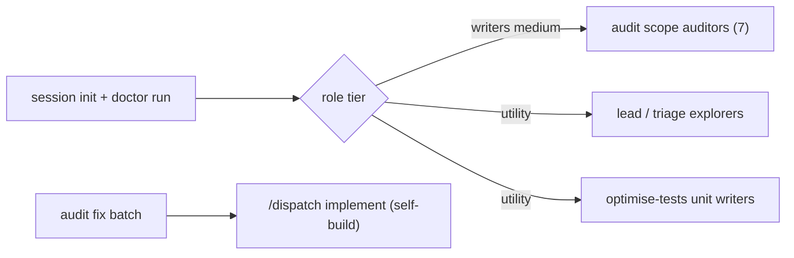

# Align Dispatch support skills with current Dispatch

> **Parent:** `.scratch/dispatch-skills/20261105T0027Z-update-audit-dispatch-skills-audit-dispa/support-skills.spec.md` · sha256:c9299d7a28545006c3f2041e4c32f6d4c42b89a5a9f3b96b26823f6788ec1d24
>
> **Decide:** approve plan and run level
>
> **Risk:** med — maintainer-only skills, but audit scope and calibration changes touch pinned tooling tests
>
> **Scope:** `.agents/skills/audit-dispatch-skills`, `.agents/skills/audit-dispatch-skills-fix`, `.agents/skills/optimise-tests`, `tests/tooling`

## At a Glance
- **What:** Bring the three maintainer support skills up to current Dispatch, add an authoring-quality audit scope, and launch their subagents on Dispatch-configured models.
- **How it works:** Skills read `doctor run` from a Dispatch session for models; the audit gains an `authoring` scope, brief and calibration case; the fix skill delivers batches through `/dispatch implement` under self-build.



Text summary: one doctor read assigns every subagent role its configured tier; fix batches run through Dispatch implement.

## Background
- Auditors and optimise writers launch as `general-purpose` with no model: `.agents/skills/audit-dispatch-skills/SKILL.md` host table and step 4; `.agents/skills/optimise-tests/SKILL.md` host table and step 2.
- `scripts/scenarios.ts` `SCOPE_CLASSES` holds five verb scopes plus `shared`; `buildPackets` maps `shared` to `references/shared.md` and every other scope to `references/walkthrough.md`. `validateCatalog` rejects entries with line pointers or missing files.
- `scripts/calibrate.ts` pins `DEFECT_CATEGORIES` (ambiguity, handoff, efficiency, recovery), `CONTROLS = 2` and `MIN_RECOVERED = 3`; `validateFixture` requires full commit and blob hashes and matching excerpt sha256 per case.
- `audit-dispatch-skills-fix/scripts/status.mjs` `PHASES` are `planned`, `plan-reviewed`, `implemented`, `code-reviewed`; checkpoints verify only that linked evidence files exist.

## Key Interfaces & Data
`doctor run` result file (read the `path`, not the 1024-byte stdout summary):

```json
{ "ok": true, "config": { "problems": [] },
  "writers": { "claude": { "models": ["claude-sonnet-5-5"], "effort": "medium" } },
  "utility": { "claude": { "models": ["claude-haiku-5-5"], "effort": "medium" } } }
```

Keys are canonical platforms `claude`, `agy`, `copilot`, `opencode`, `codex`. `models` lists alternatives ("model X or Y", as Dispatch writer briefs phrase it).

## Key Decisions & Context
- Model source, tiers, fix path, authoring scope and scenario placement follow spec DEC-1 to DEC-5.
- Each skill resolves models once per run: `node <skills-dir>/dispatch/scripts/dispatch.ts session init --objective "<skill> <run>" --host <platform>`, then `doctor run --session <session> --level medium`. Then apply one rule, as Dispatch routing does: `ok` false stops the run; no entry for the host means inline work recorded as a coverage gap; an entry the host cannot launch is a blocker.
- Launch a role on the first listed model the host accepts, with the listed effort. Keep no new record of it: `ScopeRecord` has no such field and no script needs one.
- The authoring scope gets its own brief (`references/authoring.md`) and three mandatory classes: `contradiction`, `rule-home`, `disclosure-flow`. Each class has a catalog scenario whose `entries` name the prose files to sweep, so findings keep the Scenario-id rule.
- Calibration adds category `contradiction` (five defects) and one authoring control (three controls); `MIN_RECOVERED` becomes 4 (four of five), keeping the existing ~75% bar.
- Fix batches follow DEC-6: `session init --objective "<report> <batchId>" --host <platform> --session-id <report>-<batchId>` per batch, then stop after delivery until the batch is committed.

## Constraints
- Edit only maintainer skill files and their tooling tests; no change to `skills/dispatch/**`, `scripts/**` or vendored skills.
- Keep subagent write limits: auditors and explorers write only assigned findings or map files; utility writers edit only assigned paths and run no Git write commands.
- Link Dispatch rules (routing, self-build, implement) instead of restating them; follow `.agents/skills/writing-for-agents/SKILL.md`.
- Writers locate code symbols with `codegraph explore "<symbols>"` when the CLI exists; it is not installed here, so use text search.

## Open Questions & Assumptions
- (assumption) Model resolution stays in skill prose, not a new script, because it is two CLI calls and a JSON read.
- (assumption) Copilot follows that same rule; doctor reports no Copilot entry today, so it runs inline with the coverage gap recorded.

## Out of Scope
- Provider probe behavior and its Dispatch library imports.
- Hash or term-check coverage of `.agents/` (adjacent finding, reported in handoff).
- Running a live audit, calibration or optimise-tests pass.

## Task Map

| ID | Title | Outcome | Prerequisites | Criteria |
| --- | --- | --- | --- | --- |
| T1 | Configured subagent launches | Audit and optimise-tests launch roles on doctor-resolved tiers | none | SC1, SC2 |
| T2 | Authoring audit scope | Audit selects and briefs a seventh `authoring` scope | T1 | SC3, SC8 |
| T3 | Contradiction calibration case | Calibration corpus and scorer include a contradiction defect and authoring control | T2 | SC4 |
| T4 | Current Dispatch scenarios and names | Catalog covers spec stage and routing; no stale Dispatch names remain | T2 | SC5 |
| T5 | Fix skill on Dispatch implement | Fix batches run through `/dispatch implement` under self-build with explorer triage | T4 | SC6 |

## Proposed Changes

### T1 — Configured subagent launches
- Replace host-table `general-purpose`/no-model launches with a "Subagent models" step that runs `session init` and `doctor run`, then names the doctor field per role.
- Audit: scope auditors use `writers` at `medium`; lead verification in step 5 sends multi-file reading to `utility` explorers that return cited claims; the lead keeps rulings.
- optimise-tests: unit writers use `utility`; writer brief keeps its scope and no-Git-write limits.

<details>

- #### [MODIFY] .agents/skills/audit-dispatch-skills/SKILL.md
  - Changes: host table drops per-host agent-type launch text for a tier column; new model-resolution step before step 4; step 4 brief and step 5 verification name tiers; blocker and inline rules link `skills/dispatch/SKILL.md#routing`.
  - Invariants: step numbering, `Done when` criteria, budgets and containment unchanged.
- #### [MODIFY] .agents/skills/optimise-tests/SKILL.md
  - Changes: host table and step 2 launch on `utility`; same resolution step.
  - Invariants: ownership, ledger and gate rules unchanged.

</details>

### T2 — Authoring audit scope
- `authoring` scope traces three catalog scenarios (contradiction, rule-home, disclosure-flow) across agent-facing prose: `skills/dispatch/**`, `AGENTS.md` and the support skills.
- Contradictions and duplicate rule homes are defects citing both locations; disclosure and flow improvements are opportunities.

<details>

- #### [NEW] .agents/skills/audit-dispatch-skills/references/authoring.md
  - Purpose: scope brief: axes (contradiction, rule-home, writing-for-agents conformance, progressive disclosure, streamlined flow), sweep method per scenario, both-location evidence rule, defect vs opportunity split; reuses findings.md format and walkthrough budgets.
  - Reuse: `references/shared.md` and `references/walkthrough.md` are verb- and boundary-specific; none fits a prose sweep.
- #### [MODIFY] .agents/skills/audit-dispatch-skills/scripts/scenarios.ts
  - Changes: `SCOPE_CLASSES.authoring = ['contradiction', 'rule-home', 'disclosure-flow']`; `buildPackets` maps `authoring` to `references/authoring.md`; header comment names seven scopes.
- #### [MODIFY] .agents/skills/audit-dispatch-skills/references/scenarios.json
  - Changes: three `authoring` scenarios, one per class, with file entries only.
- #### [MODIFY] .agents/skills/audit-dispatch-skills/config.json
  - Changes: `limits.scopes` 7.
- #### [MODIFY] .agents/skills/audit-dispatch-skills/SKILL.md
  - Changes: intro counts seven scope auditors and names the authoring scope.
- #### [MODIFY] tests/tooling/audit-scenarios.test.ts
  - Changes: default selection and packet count include `authoring` with its brief reference.
- #### [MODIFY] tests/tooling/audit-state.test.ts
  - Changes: `limits.scopes` expectation 7.

</details>

### T3 — Contradiction calibration case
- Corpus gains one real historical contradiction and one authoring control; scorer requires four of five recovered defects.
- Defect: at parent `56f4718aa154820ceb0ce018c00cb959e5836f26`, `skills/dispatch/README.md:136` says Dispatch does not commit while `skills/dispatch/references/toolkit.md:56` defines an integration fix commit; fix commit `e475433fd6e2169d2025c69deab088bbb5fbabd1`.
- Control: at `6ecffbd210d3f5999c210d0b79e8ffd37254eb52`, `skills/dispatch/references/templates/quality-bar.md:18,34` state an intentional no-duplication rule and its collapsed-detail exception.

<details>

- #### [MODIFY] .agents/skills/audit-dispatch-skills/scripts/calibrate.ts
  - Changes: `DEFECT_CATEGORIES` adds `contradiction`; `CONTROLS` 3; `MIN_RECOVERED` 4.
- #### [MODIFY] .agents/skills/audit-dispatch-skills/fixtures/calibration/cases.json
  - Changes: add `defect-*` case (category `contradiction`) and `control-*` case with commit, parent, blob, line ranges and excerpt sha256 from `git show`; `briefs.new.paths` adds `references/authoring.md`.
  - Invariants: existing six cases unchanged; excerpts verbatim from the pinned blob.
- #### [MODIFY] .agents/skills/audit-dispatch-skills/references/calibration.md
  - Changes: every corpus-size and control-count reference (introduction L3, objective L5, pass rule L47, limit L49) reads five defects, three controls and eight cases, and the pass rule reads four of five defects and no defect against any control; line 12 replaces `dispatch.ts start`/`send` with current toolkit actions.
- #### [MODIFY] tests/tooling/audit-calibration.test.ts
  - Changes: corpus-shape and pass-threshold expectations, including the test title.
- #### [MODIFY] tests/tooling/audit-calibration-scoring.test.ts
  - Changes: threshold boundary uses four of five; `controlFalseDefects` length 3.

</details>

### T4 — Current Dispatch scenarios and names
- Catalog adds a `plan` `decision` scenario covering spec stage (grounding, critique, grilling, confirm) and an `implement` `normal` scenario covering explorer/utility routing and test cleanup.
- Stale names replaced: `dispatch.ts start`/`send` become "running Dispatch session or toolkit actions"; absent example paths use current files.

<details>

- #### [MODIFY] .agents/skills/audit-dispatch-skills/references/scenarios.json
  - Changes: two scenarios with entries `skills/dispatch/references/spec-stage.md`, `skills/dispatch/references/grounding.md`, `skills/dispatch/SKILL.md`, `skills/dispatch/references/verbs/implement.md`.
- #### [MODIFY] .agents/skills/audit-dispatch-skills/references/walkthrough.md
  - Changes: static-only constraint names current entry actions.
- #### [MODIFY] .agents/skills/audit-dispatch-skills-fix/references/triage-and-state.md
  - Changes: example `affectedPaths` names a file present at HEAD.
- #### [MODIFY] .agents/skills/optimise-tests/references/criteria.md
  - Changes: example records name a test file present at HEAD.

</details>

### T5 — Fix skill on Dispatch implement
- Constraints: follows T4 because both edit `triage-and-state.md`.
- Each batch opens its own session with `session init --objective "<report> <batchId>" --host <platform> --session-id <report>-<batchId>`. The `/dispatch` invocation carries the returned path, and that run uses it for every tool call, frozen-controller call and recovery instead of initializing again. After delivery the skill stops until the batch is committed, and commits itself only when the invocation authorized that.
- Step 4–5 become one Dispatch run: `/dispatch <level> implement:` with batch context under `skills/dispatch/references/self-build.md`; plan, plan review, implementation and code review evidence map to the four existing checkpoints.
- Step 2 triage sends multi-file source reading to `utility` explorers resolved as in T1; the lead keeps rulings.

<details>

- #### [MODIFY] .agents/skills/audit-dispatch-skills-fix/SKILL.md
  - Changes: frontmatter description drops direct implementation; delete the Dispatch-implement ban; rewrite steps 4–5; add the per-batch session and commit stop to step 6; add model-resolution line for triage explorers; resume rule follows Dispatch `status show`.
  - Invariants: report-owned state, selection rules and `fixed` preconditions unchanged.
- #### [MODIFY] .agents/skills/audit-dispatch-skills-fix/references/triage-and-state.md
  - Changes: checkpoint evidence names Dispatch artifacts (plan, review results, walkthrough); the `implemented` row no longer says direct implementation; every Recovery row reconciles the batch's retained Dispatch session through `status show` before advancing a checkpoint; retired frame, journal and run terms become session and ledger terms.
  - Invariants: `progress` and `triage` JSON schemas unchanged.
- #### [MODIFY] tests/tooling/audit-report-progress.test.ts
  - Changes: test title drops "direct delivery".

</details>

## Success Criteria
- [SC1] Audit and optimise-tests name `session init`, `doctor run` and a doctor tier for every subagent role, with no host-default launch left.
  <details>

  - Satisfies: REQ-1, REQ-2
  - Changes: .agents/skills/audit-dispatch-skills/SKILL.md, .agents/skills/optimise-tests/SKILL.md
  - Evidence: review
  - Review: artifact: both SKILL.md files; scenario: read each launch site; pass: every launch names `writers` medium or `utility`, the blocker and inline rules link Dispatch routing, and no `general-purpose` launch without a model remains.

  </details>
- [SC2] No support skill script reads Dispatch config model fields for subagent launch.
  <details>

  - Satisfies: REQ-1
  - Changes: .agents/skills/audit-dispatch-skills/SKILL.md
  - Evidence: review
  - Review: artifact: `.agents/skills/*/scripts/`; scenario: search for `write-subagents`, `explore-subagents` and `config.local`; pass: no hit outside the unchanged provider probe.

  </details>
- [SC3] The audit selects an `authoring` scope with three classes and packets pointing at its brief.
  <details>

  - Satisfies: REQ-3
  - Changes: .agents/skills/audit-dispatch-skills/scripts/scenarios.ts, .agents/skills/audit-dispatch-skills/references/scenarios.json, .agents/skills/audit-dispatch-skills/references/authoring.md, .agents/skills/audit-dispatch-skills/config.json, tests/tooling/audit-scenarios.test.ts, tests/tooling/audit-state.test.ts
  - Tests: tests/tooling/audit-scenarios.test.ts, tests/tooling/audit-state.test.ts
  - Verify: `node --test --import=./tests/helpers/isolated-temp.ts --import=./tests/helpers/block-spawn.ts --test-reporter=./scripts/test-reporter.ts tests/tooling/audit-scenarios.test.ts tests/tooling/audit-state.test.ts`
  - RED: `node --test --import=./tests/helpers/isolated-temp.ts --import=./tests/helpers/block-spawn.ts --test-reporter=./scripts/test-reporter.ts tests/tooling/audit-scenarios.test.ts`
  - Evidence: red

  </details>
- [SC4] Calibration validates five defect categories including `contradiction` and three controls, and passes at four recovered defects.
  <details>

  - Satisfies: REQ-3
  - Changes: .agents/skills/audit-dispatch-skills/scripts/calibrate.ts, .agents/skills/audit-dispatch-skills/fixtures/calibration/cases.json, .agents/skills/audit-dispatch-skills/references/calibration.md, tests/tooling/audit-calibration.test.ts, tests/tooling/audit-calibration-scoring.test.ts
  - Tests: tests/tooling/audit-calibration.test.ts, tests/tooling/audit-calibration-scoring.test.ts
  - Verify: `node --test --import=./tests/helpers/isolated-temp.ts --import=./tests/helpers/block-spawn.ts --test-reporter=./scripts/test-reporter.ts tests/tooling/audit-calibration.test.ts tests/tooling/audit-calibration-scoring.test.ts`
  - RED: `node --test --import=./tests/helpers/isolated-temp.ts --import=./tests/helpers/block-spawn.ts --test-reporter=./scripts/test-reporter.ts tests/tooling/audit-calibration.test.ts`
  - Evidence: red

  </details>
- [SC5] The catalog covers spec stage and routing, and no support skill instruction names an absent Dispatch command, file or anchor.
  <details>

  - Satisfies: REQ-4
  - Changes: .agents/skills/audit-dispatch-skills/references/scenarios.json, .agents/skills/audit-dispatch-skills/references/walkthrough.md, .agents/skills/audit-dispatch-skills-fix/references/triage-and-state.md, .agents/skills/optimise-tests/references/criteria.md
  - Verify: `node --test --import=./tests/helpers/isolated-temp.ts --import=./tests/helpers/block-spawn.ts --test-reporter=./scripts/test-reporter.ts tests/tooling/audit-scenarios.test.ts`
  - Evidence: review
  - Review: artifact: the three skills' `SKILL.md` and `references/*.md`; scenario: check every named Dispatch path, anchor and command against HEAD; pass: all resolve, calibration fixture excerpts excepted.

  </details>
- [SC6] The fix skill runs each batch through `/dispatch implement` under self-build and maps its checkpoints to Dispatch evidence.
  <details>

  - Satisfies: REQ-5, REQ-2, REQ-1
  - Changes: .agents/skills/audit-dispatch-skills-fix/SKILL.md, .agents/skills/audit-dispatch-skills-fix/references/triage-and-state.md, tests/tooling/audit-report-progress.test.ts
  - Tests: tests/tooling/audit-report-progress.test.ts
  - Verify: `node --test --import=./tests/helpers/isolated-temp.ts --import=./tests/helpers/block-spawn.ts --test-reporter=./scripts/test-reporter.ts tests/tooling/audit-report-progress.test.ts`
  - Evidence: review
  - Review: artifact: fix `SKILL.md`; scenario: follow one batch from triage to `fixed`; pass: no Dispatch-implement ban, self-build linked, `session init` and `doctor run` named for triage explorers, a second batch uses a distinct session whose path the run keeps through recovery, an interrupted batch resumes from its session at each checkpoint, commit stop stated, each of the four checkpoints names its Dispatch evidence, triage explorers named with tier.

  </details>
- [SC7] The full suite and e2e suite pass after the last change.
  <details>

  - Satisfies: REQ-6
  - Changes: .agents/skills/audit-dispatch-skills/scripts/scenarios.ts, .agents/skills/audit-dispatch-skills/scripts/calibrate.ts
  - Verify: `npm run test:all`
  - Evidence: verify
  - Integration: suite gate spans T2–T4 script changes.

  </details>

- [SC8] The authoring brief defines its sweep, evidence and classification rules.
  <details>

  - Satisfies: REQ-3
  - Changes: .agents/skills/audit-dispatch-skills/references/authoring.md
  - Evidence: review
  - Review: artifact: `references/authoring.md`; scenario: read it as an auditor assigned each class; pass: target paths include `skills/dispatch/**`, `AGENTS.md` and the support skills, all axes are named, contradictions and duplicate rule homes are defects citing both locations, and disclosure and flow improvements are opportunities.

  </details>

## Verification Plan
- Seams: tests/integration/skill-contract.test.ts, tests/tooling/audit-scenarios.test.ts, tests/tooling/audit-state.test.ts, tests/tooling/audit-calibration.test.ts, tests/tooling/audit-calibration-scoring.test.ts, tests/tooling/audit-report-progress.test.ts
### Automated Tests
- `node --test --import=./tests/helpers/isolated-temp.ts --import=./tests/helpers/block-spawn.ts --test-reporter=./scripts/test-reporter.ts tests/integration/skill-contract.test.ts`
- `node --test --import=./tests/helpers/isolated-temp.ts --import=./tests/helpers/block-spawn.ts --test-reporter=./scripts/test-reporter.ts tests/e2e/audit-tooling.test.ts`
### Manual Verification
- Read one rendered `authoring` packet from `scenarios.ts` against `references/authoring.md` for path and class agreement.

## Rollback & Blast Radius
- Unchanged consumers: `scripts/baseline.mjs`, `scripts/finalize.mjs`, `scripts/probe-dispatch.mjs`, `audit-dispatch-skills-fix/scripts/status.mjs`, `optimise-tests/scripts/*`.
- All edits are maintainer-only files; revert by commit. No Dispatch hash, schema or shipped behavior changes.

## Review Findings & Resolutions

| Review | ID | Round | Severity | Source | Status | Ruling |
| --- | --- | --- | --- | --- | --- | --- |
| plan-support-skills.plan | R1-F001 | 1 | MUST | gpt-6.1-terra/xhigh | Accepted | Key Decisions said both stop and inline for an absent entry; one rule now match… |
| plan-support-skills.plan | R1-F002 | 1 | MUST | gpt-6.1-terra/xhigh | Accepted | dispatch.ts:48 uses the chat identity without --session-id; the batch path now … |
| plan-support-skills.plan | R1-F003 | 1 | MUST | gpt-6.1-terra/xhigh | Accepted | triage-and-state.md Recovery table still says implement directly; T5 now rewrit… |
| plan-support-skills.plan | R1-F004 | 1 | SHOULD | gpt-6.1-terra/xhigh | Accepted | cases.json briefs.new.paths omits the authoring brief; T3 adds it. |
| plan-support-skills.plan | R1-F005 | 1 | SHOULD | gpt-6.1-terra/xhigh | Accepted | SC3 tests only selection; SC8 reviews the brief content. |
| plan-support-skills.plan | R1-F006 | 1 | SHOULD | gpt-6.1-terra/xhigh | Rejected | AGENTS.md Plan checks lets a criterion Verify run a full test file, and host ru… |
| plan-support-skills.plan | R1-F007 | 1 | MUST | gpt-6.1-terra/xhigh | Accepted | The helper was outside Scope; removed because it needs no change, per R1-F012. |
| plan-support-skills.plan | R1-F008 | 1 | SHOULD | gemini-3.8-flash/medium | Rejected | Plan line 3 already backticks the path and matches SPEC_PIN_VALUE; lint reports… |
| plan-support-skills.plan | R1-F009 | 1 | SHOULD | gemini-3.8-flash/medium | Accepted | Lint warned undeclared-test-path; SC6 now lists Tests. |
| plan-support-skills.plan | R1-F010 | 1 | SHOULD | gemini-3.8-flash/medium | Accepted | REQ-1 covers three skills; SC6 now satisfies REQ-1 for the fix skill. |
| plan-support-skills.plan | R1-F011 | 1 | SHOULD | gemini-3.8-flash/medium | Duplicate | Same Recovery table defect as R1-F003. |
| plan-support-skills.plan | R1-F012 | 1 | SHOULD | gemini-3.8-flash/medium | Accepted | The helper reads cases.json with no builders, the claims test has no counts, an… |
| plan-support-skills.plan | R1-F013 | 1 | SHOULD | gemini-3.8-flash/medium | Rejected | audit-scenarios.test.ts:157 validates the bundled catalog against the checkout,… |

- Round 1 (plan-support-skills.plan): 13 findings — [findings](../20261105T0130Z-continue-support-skills-plan/.state/reviews/plan-support-skills.plan/round-1/findings.json)

- Round 2 (plan-support-skills.plan): 0 findings — [findings](../20261105T0130Z-continue-support-skills-plan/.state/reviews/plan-support-skills.plan/round-2/findings.json)

Budget (plan-support-skills.plan): next round 3 requires-continuation (cap 2, ceiling 4)

