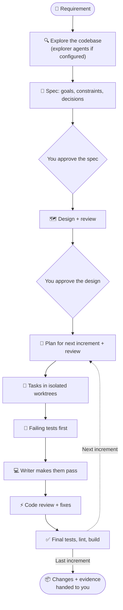

# dispatch-skills

[](package.json)
[](LICENSE)
[](package.json)

Build with more confidence by catching flawed assumptions before they become code. `dispatch-skills` brings independent agents into one development workflow for planning, implementation, and review — without leaving the agent IDE or CLI you prefer. Agents work through their native harnesses, while your host agent verifies their findings against the real code and carries the work forward.

## Contents

- [Why dispatch-skills?](#why-dispatch-skills)
- [Key differentiators](#key-differentiators)
- [Install](#install)
- [Skills](#skills)
- [Quick start](#quick-start)
- [License](#license)

## Why dispatch-skills?

Most agent workflows ask one model to make the assumptions, do the work, and judge the result. `dispatch-skills` brings other agent platforms into the process. Your host agent keeps control of the working tree, while independent models help plan, review, and cross-check the work. Start with the agent you already use, then add other CLIs when you want another perspective.

For a large change, dispatch breaks the design into smaller increments. Each increment is planned, reviewed, implemented, and verified before the next begins:



Every workflow except a quick question starts by agreeing on one **spec**: the outcome, constraints, and decisions that everything else is checked against. At level `medium` and above you approve the spec before any design or plan is written; at `low` Dispatch proceeds and shows you the spec at the end. Smaller changes skip the design and go straight to a single plan. See [document layers and approvals](skills/dispatch/references/readme/concepts.md#spec-design-and-plan).

## Key differentiators

### Collaborate across agent platforms

| What dispatch does | Why it matters |
|---|---|
| **🔌 Works across native agent platforms** | Keep working in whichever supported agent IDE or CLI you prefer while drawing on models from other platforms. Each delegate uses its native harness and allowed tools. |
| **🎲 Prioritizes independent model families** | Shared blind spots are less likely to survive review. Dispatch asks cross-platform reviewers first and leaves your host platform and active model until last. |

### Improve review quality

| What dispatch does | Why it matters |
|---|---|
| **💡 Reviews designs and plans before implementation** | Catch a missing migration in the plan instead of after hundreds of lines of code, making implementation more likely to succeed on the first pass. |
| **⚖️ Verifies evidence instead of counting votes** | Reviewers cite `file:L<line>` or `§ plan section`, and your host agent checks each finding against the code and repository instructions. Unsupported or contradicted findings are rejected, while one well-supported defect is enough to act on. |

### Keep operations safe and efficient

| What dispatch does | Why it matters |
|---|---|
| **🛡️ Keeps read delegates read-only** | Ambient credential variables are stripped; sensitive attachments are rejected. Native authenticated state remains available, and prompt guardrails guide file reads. Supported platforms add an OS sandbox for another layer of protection. After the plan settles, a writer on the host platform makes production changes. |
| **🧾 Passes focused context between agents** | Scripts handle routing, retries, data formats, artifacts, and logs. Noisy output stays in session files, while structured handoffs preserve cited findings and progress for the next phase. |
| **⚡ Reviews changes before the PR** | Review uncommitted work directly in your terminal while its context is still fresh. An automated loop can apply verified fixes and run the checks again. |
| **💰 Spreads work across providers** | Use the CLIs you already pay for, reduce your dependence on any one provider's rate limits, and keep working in your preferred IDE while other models do the reading. |

## Install

```bash
# Latest from main
npx skills add Gyunikuchan/dispatch-skills -s '*'

# Specific branch or tag
npx skills add Gyunikuchan/dispatch-skills#<branch-or-tag> -s '*'
```

Requires Node.js `^22.18 || >=23.6` with native TypeScript stripping and at least one supported agent CLI on your `PATH`:

- Claude Code
- Antigravity
- GitHub Copilot
- OpenCode
- Codex

Nothing is enabled until you create a config. Copy `skills/dispatch/config.sample.jsonc` to `config.jsonc` (or `config.local.jsonc`) beside it, then keep only the models you actually want to use. Check the resulting configuration with:

```bash
node skills/dispatch/scripts/dispatch.ts session init --objective "Check Dispatch setup"
node skills/dispatch/scripts/dispatch.ts doctor run --session <returned-session-path> --level high
```

> [!NOTE]
> Install every skill into the same scope — all project-local or all global (`-g`). The aliases resolve `dispatch` as a sibling, so a mixed install breaks them.

> [!NOTE]
> Exclude installed skill directories from your formatters and linters. Dispatch checks its own files for integrity; whitespace-level Markdown and JSON reformatting is tolerated, but rewritten lists or `.ts` files fail the check.

> [!NOTE]
> Where a provider supports it, read delegates run in an OS sandbox by default. Setting `sandbox: false` on a provider turns that off; the provider's own read-only mode still applies but is a weaker boundary. Antigravity uses plan mode as its write boundary.

See [`skills/dispatch/README.md`](skills/dispatch/README.md) for the Dispatch user guide, workflow choices, configuration, and troubleshooting.

## Skills

| Skill | Use it for |
|---|---|
| [`dispatch`](skills/dispatch/README.md) | Everything below, plus one-off delegation. Runs only when you invoke it. |
| [`dispatch-plan`](skills/dispatch/references/readme/plan.md) | Alias for `/dispatch plan:` |
| [`dispatch-code-review`](skills/dispatch/references/readme/review.md) | Alias for `/dispatch review code:` |
| [`dispatch-implement`](skills/dispatch/references/readme/implement.md) | Alias for `/dispatch implement:` |

The three aliases exist for familiar slash commands only; `dispatch` alone does the work.

## Quick start

```text
/dispatch [level] [(pins)] [ask|design|plan|review|implement]: <argument>
```

All parts except the argument are optional; the default verb is `ask`.

- **Level** (`low`, `medium`, `high`, `xhigh`, `max`) picks which configured models and how much review to use. Leave it out and Dispatch proposes one for you to confirm.
- **Pins** such as `(claude,agy)`, `(3)`, or `(all)` choose which configured providers answer.

Ask another model a bounded question:

```text
/dispatch: Trace discount stacking in src/domain/pricing.ts
/dispatch (all): Does the cache invalidation flow have a race?
```

Write a plan, then optionally run an additional review pass:

```text
/dispatch high (claude,agy) plan: Add webhook idempotency
/dispatch review: .scratch/dispatch-skills/<folder>/webhooks.plan.md
```

`plan:` already reviews and fixes the plan as its level allows. The second command is an optional extra review pass.

Review your working tree or a branch range:

```text
/dispatch review code
/dispatch review code: main..HEAD
```

> [!NOTE]
> With no range, only uncommitted changes (staged, unstaged, and untracked) are reviewed. Name a range to review commits.

In each review, your host agent checks every finding, applies the accepted safe fixes, then verifies and reviews again. Findings that depend on your intent are brought to you.

Run the whole loop — spec, plan and review, your approval, implementation, and code review:

```text
/dispatch implement: Add CSV export
/dispatch implement: .scratch/dispatch-skills/<folder>/csv.plan.md
```

For work too big for one pass, `design:` creates and reviews an increment graph. Approve the design, then invoke `implement:` on its artifact to deliver the increments:

```text
/dispatch design: Migrate the billing state machine
```

> [!NOTE]
> Dispatch works in its own internal worktrees and commits, then delivers the result as unstaged changes in your checkout. It never commits on your branch, pushes, or opens a PR. Session files live under `.scratch/dispatch-skills/`, so interrupted runs can resume; the handoff gives the folder path.

For help resuming interrupted work, see [Troubleshooting](skills/dispatch/references/readme/troubleshooting.md).

## License

MIT © [Gyunikuchan](https://github.com/Gyunikuchan). See [LICENSE](LICENSE).
