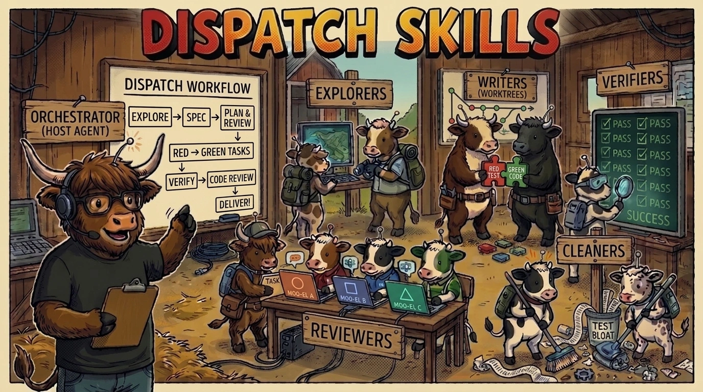
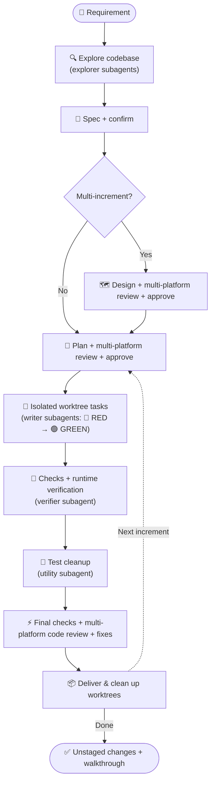

# dispatch-skills

[](package.json)
[](LICENSE)
[](package.json)



**Turn your coding agent into an end-to-end orchestrator across native subagents and multi-platform delegates.** `dispatch-skills` puts your host agent in charge of a specialized team: fast native subagents explore code and run cleanup, independent models across platforms answer questions and review designs, plans, and code, and native writers build tested changes in isolated worktrees—delivering verified, unstaged code ready to inspect.

## Why dispatch-skills?

Single-agent workflows ask one model to make assumptions, burn its context window reading files, write the code, and grade its own work. Dispatch separates those roles across native subagents and cross-platform CLI delegates:

| Benefit | How Dispatch delivers it |
|---|---|
| **🧭 Host agent as your deputy** | Your current agent orchestrates the workflow—routing tasks to native subagents and cross-platform CLI delegates while keeping your main context clean. |
| **⚡ Specialized native subagents** | Fast explorer and utility subagents map the codebase and prune redundant tests; scoped writer and verifier subagents build and prove changes in parallel. |
| **🎲 Cross-platform perspectives** | Independent reviewers on other platforms run first and your host platform runs last, catching shared blind spots across model families. |
| **💡 Catch design & plan flaws early** | Designs and plans are reviewed and fixed before a single line is written, surfacing missing edge cases or migrations upfront. |
| **⚖️ Evidence, not votes** | Reviewers must cite `file:L<line>` or plan sections; your host agent checks every claim against real code and rejects unsupported noise. |
| **🔴 Test-first & runtime-verified** | Writers capture failing tests (RED) before code (GREEN), runtime verification proves behavior, and test cleanup removes redundant assertions. |
| **🌿 Isolated worktrees, clean delivery** | Parallel tasks run in isolated internal worktrees and deliver clean unstaged changes—never committing, pushing, or opening PRs behind your back. |
| **🛡️ Structural least privilege** | External CLI delegates run read-only in OS sandboxes with ambient credentials stripped; only host-platform writers touch code after your approval. |
| **🎚️ Proportional to risk & budget** | Scale model tiers and review depth (`low`–`max`) to the task, mix subscriptions you already own (Claude Code, Antigravity, Copilot, OpenCode, Codex), and track optional token/cost diagnostics. |

## How it works

Every workflow except a quick question (`ask`) starts by grounding the codebase and confirming one **spec**. Large cross-boundary work flows through a **design** and ordered increments; focused changes go straight to a **plan**.



- **Confirm before authoring:** You confirm the spec before any design or plan is written at every level.
- **Approve before coding:** At `medium` and above, you approve the plan or design before implementation; at `low`, Dispatch proceeds after spec confirmation and shows artifacts at handoff. See [document layers and approvals](skills/dispatch/references/readme/concepts.md#spec-design-and-plan).

## Quick start

```text
/dispatch [level] [(pins)] [ask|design|plan|review|implement|verify]: <argument>
```

Only the argument is required (default verb: `ask`).

- **Level** (`low`, `medium`, `high`, `xhigh`, `max`): sets model tiers and review depth. Omit it and Dispatch proposes one.
- **Pins** (`(claude,agy)`, `(3)`, `(all)`): choose which configured providers or target count answer.

```text
# Ask another model, or every configured model, a focused question
/dispatch: Trace discount stacking in src/domain/pricing.ts
/dispatch (all): Does the cache invalidation flow have a race?

# Write and review a plan
/dispatch high (claude,agy) plan: Add webhook idempotency

# Review uncommitted changes, or a Git commit range
/dispatch review code
/dispatch review code: main..HEAD

# Implement from a requirement or an approved plan/design
/dispatch implement: Add CSV export
/dispatch implement: .scratch/dispatch-skills/<folder>/csv.plan.md

# Large change: approve the design, then implement its increments
/dispatch design: Migrate the billing state machine
```

> [!NOTE]
> Dispatch works in isolated internal worktrees and delivers the verified result as **unstaged changes** in your checkout (see [design delivery](skills/dispatch/references/readme/implement.md#design-delivery) for increment commits). It never pushes or opens a PR. Session artifacts live under `.scratch/dispatch-skills/` so interrupted runs can resume.

## Install

Requires Node.js `^22.18 || >=23.6` and at least one supported agent CLI on your `PATH` (Claude Code, Antigravity, GitHub Copilot, OpenCode, or Codex).

```bash
# Latest from main
npx skills add Gyunikuchan/dispatch-skills -s '*'

# Specific branch or tag
npx skills add Gyunikuchan/dispatch-skills#<branch-or-tag> -s '*'
```

Copy `skills/dispatch/config.sample.jsonc` to `config.jsonc` (or `config.local.jsonc`) beside it, keep only the providers you use, and verify your setup (`<platform>` is `claude`, `agy`, `copilot`, `opencode`, or `codex`):

```bash
node skills/dispatch/scripts/dispatch.ts session init --objective "Check Dispatch setup" --host <platform>
node skills/dispatch/scripts/dispatch.ts doctor run --session <returned-session-path> --host <platform> --level high
```

> [!NOTE]
> - Install all skills in the same scope (all project-local or all global `-g`) so aliases can find sibling `dispatch`.
> - Exclude installed skill directories from formatters and linters; Dispatch verifies its own script and reference integrity.

## Skills & docs

Only `dispatch` runs the workflow; the aliases map familiar slash commands to `dispatch`.

| Skill | Purpose |
|---|---|
| [`dispatch`](skills/dispatch/README.md) | Full operational user guide (all verbs) |
| [`dispatch-plan`](skills/dispatch/references/readme/plan.md) | Alias for `/dispatch plan:` |
| [`dispatch-implement`](skills/dispatch/references/readme/implement.md) | Alias for `/dispatch implement:` |
| [`dispatch-verify`](skills/dispatch/references/readme/verify.md) | Alias for `/dispatch verify:` |
| [`dispatch-code-review`](skills/dispatch/references/readme/review.md) | Alias for `/dispatch review code:` |

- [Configuration](skills/dispatch/references/readme/configuration.md): levels, pins, model selection, sandboxing, and cost overrides
- [Troubleshooting](skills/dispatch/references/readme/troubleshooting.md): diagnostics, resuming interrupted runs, and common errors

## Compare matched runs

Use the same task, acceptance criteria and review setup on both sides. Keep the diagnostics captures and host usage stores readable. In `pairs.json`, session paths are relative to the file and the pricing path is relative to the working directory. The optional `reportComplete` path is relative to its own session and points to the saved result of `report complete`.

```sh
node scripts/measure-runs.ts pairs.json --out .scratch/comparison
```

This synthetic example uses one completed plan review round per side. Both runs use model `m` and a fixed `pricing.json` dated 2026-11-19, with base rates of USD 2 per million input tokens and USD 10 per million output tokens. Both take the base rates on the fixture date, 2020-01-01.

<details>
<summary>Example pairs.json</summary>

```json
{
  "pricing": "pricing.json",
  "pairs": [
    {
      "name": "plan",
      "sides": [
        {
          "label": "baseline",
          "session": "./.scratch/dispatch-skills/20200101T0000Z-plan-baseline",
          "host": "claude"
        },
        {
          "label": "candidate",
          "session": "./.scratch/dispatch-skills/20200101T0001Z-plan-candidate",
          "host": "claude",
          "reportComplete": ".state/results/report-complete-00000000-0000-4000-8000-000000000001.json"
        }
      ]
    }
  ],
  "confounds": [
    "one synthetic run per side"
  ]
}
```

</details>

Selected rows from `comparison.md`

| Metric | baseline | candidate |
| --- | ---: | ---: |
| Host tokens in rounds | 90000 | 50000 |
| Cost (USD) | ~$0.44 (partial) | ~$0.27 (partial) |
| Delegate usage source | 1 session, 1 stdout fallback | 1 session |
| Uncached input / matched response | 33333.33 · 100000 input / 3 events | 20000.00 · 60000 input / 3 events |
| Recovery (extra CLI / superseded CLI / writer relaunches) | 1 / 0 / 0 · observed | 0 / 0 / 0 · observed |
| Retry and rework costs by cause | timeout 1 (~$0.09) | — |
| Review finding occurrences | 0 accepted · 0 rejected · 1 recurring | 0 accepted · 0 rejected · 0 recurring |
| Verification | unavailable | 1 verified · 0 manual · 0 waived · 0 missing · SC1 verified |

Comparison limits — usage coverage differs, response event basis or coverage differs, review workload or outcomes differ, verification evidence unavailable

The matched subset contains one host and two delegate responses on each side. The candidate supplies 40,000 fewer uncached input tokens to that subset. The observed CLI attempt span falls from 6s to 2s as the candidate completes with one launch and the baseline retries after a timeout. The retry adds an estimated $0.09 to the baseline. The baseline also has one recurring finding, and only the candidate supplies a completed verification record.

Treat both dollar figures as priced subtotals. Both sides lack subagent evidence, and the baseline also uses stdout fallback for the timed-out launch. The comparison limits and the different review and verification evidence leave savings unproven. Use `comparison.json` for unrounded cost bounds, per-stage response evidence, per-round spans and criterion states. Keep the same table and check applied tariff periods and rate matches when evaluating other pairs.

## License

MIT © [Gyunikuchan](https://github.com/Gyunikuchan). See [LICENSE](LICENSE).
