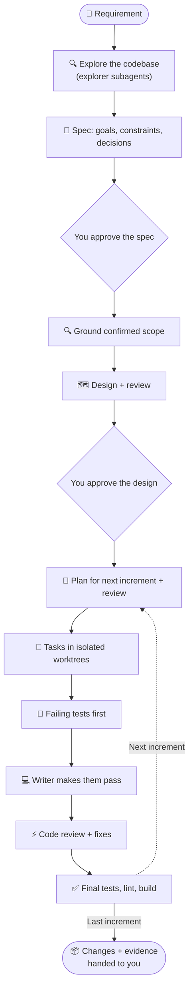

# dispatch-skills

[](package.json)
[](LICENSE)
[](package.json)

Catch flawed assumptions before they become code. `dispatch-skills` turns the agent IDE or CLI you already use into an orchestrator: it sends research, routine work, and review to native subagents and to independent models on other platforms, checks their findings against the real code, and keeps the decisions.

## Why dispatch-skills?

Most agent workflows ask one model to make the assumptions, do the work, and judge the result. Dispatch separates those roles:

- **🎲 Independent model families.** Cross-platform reviewers are asked first, and your host platform and active model last, so shared blind spots are less likely to survive review. Each delegate runs in its native harness with its allowed tools.
- **💡 Review before implementation.** Designs and plans are reviewed too, so a missing migration surfaces in the plan instead of after hundreds of lines of code.
- **⚖️ Evidence, not votes.** Reviewers cite `file:L<line>` or `§ plan section`, and your host agent checks each finding against the code and repository instructions. It rejects unsupported findings; one well-supported defect is enough to act on.
- **⚡ Review before the PR.** Review uncommitted work in your terminal while its context is fresh. An automated loop can apply verified fixes and run the checks again.
- **🛡️ Read-only delegates.** Ambient credential variables are stripped and sensitive attachments rejected, though native authenticated state remains available. Where a provider supports it, delegates also run in an OS sandbox (`sandbox: false` turns this off, leaving the provider's weaker read-only mode); Antigravity uses plan mode as its write boundary. Only a writer on your host platform makes production changes, after the plan settles.
- **🧾 Focused context.** Scripts handle routing, retries, artifacts, and logs. Noisy output stays in session files, while structured handoffs carry cited findings and progress to the next phase.
- **💰 Spread across providers.** Use the CLIs you already pay for and depend less on any one provider's rate limits.

## How it works

Every workflow except a quick question starts by agreeing on one **spec**: the outcome, constraints, and decisions that everything else is checked against. At level `medium` and above you approve the spec before any design or plan is written; at `low` Dispatch proceeds and shows you the spec at the end.

A large change is split into increments, each planned, reviewed, implemented, and verified before the next begins. Smaller changes skip the design and go straight to a single plan. See [document layers and approvals](skills/dispatch/references/readme/concepts.md#spec-design-and-plan).



## Install

You need Node.js `^22.18 || >=23.6` and at least one supported agent CLI on your `PATH`: Claude Code, Antigravity, GitHub Copilot, OpenCode, or Codex.

```bash
# Latest from main
npx skills add Gyunikuchan/dispatch-skills -s '*'

# Specific branch or tag
npx skills add Gyunikuchan/dispatch-skills#<branch-or-tag> -s '*'
```

Nothing is enabled until you create a config. Copy `skills/dispatch/config.sample.jsonc` to `config.jsonc` (or `config.local.jsonc`) beside it and keep only the models you want to use. Then check the setup:

```bash
node skills/dispatch/scripts/dispatch.ts session init --objective "Check Dispatch setup"
node skills/dispatch/scripts/dispatch.ts doctor run --session <returned-session-path> --level high
```

> [!NOTE]
> - Install every skill into the same scope, all project-local or all global (`-g`). The aliases find `dispatch` as a sibling, so a mixed install breaks them.
> - Exclude installed skill directories from your formatters and linters. Dispatch checks its own files for integrity; whitespace-level Markdown and JSON reformatting is tolerated, but rewritten lists or `.ts` files fail the check.

## Quick start

```text
/dispatch [level] [(pins)] [ask|design|plan|review|implement]: <argument>
```

Only the argument is required; the default verb is `ask`.

- **Level** (`low`, `medium`, `high`, `xhigh`, `max`) sets which configured models run and how much review they do. Leave it out and Dispatch proposes one for you to confirm.
- **Pins** such as `(claude,agy)`, `(3)`, or `(all)` choose which configured providers answer.

```text
# Ask another model, or every configured model, a bounded question
/dispatch: Trace discount stacking in src/domain/pricing.ts
/dispatch (all): Does the cache invalidation flow have a race?

# Write and review a plan
/dispatch high (claude,agy) plan: Add webhook idempotency

# Review uncommitted changes, or name a range to review commits
/dispatch review code
/dispatch review code: main..HEAD

# Run the whole loop, from a requirement or an existing plan
/dispatch implement: Add CSV export
/dispatch implement: .scratch/dispatch-skills/<folder>/csv.plan.md

# Work too big for one pass: approve the design, then run implement on it
/dispatch design: Migrate the billing state machine
```

In every review, your host agent checks each finding, applies accepted safe fixes, then verifies and reviews again. It brings you findings that depend on your intent.

> [!NOTE]
> Dispatch works in its own internal worktrees and commits, then delivers the result as unstaged changes in your checkout. It never commits on your branch, pushes, or opens a PR. Session files live under `.scratch/dispatch-skills/`, so interrupted runs can resume; the handoff gives the folder path.

## Skills

Only `dispatch` does the work, and it runs only when you invoke it. The aliases exist for familiar slash commands.

| Skill | Use it for |
|---|---|
| [`dispatch`](skills/dispatch/README.md) | Every verb above, including one-off delegation |
| [`dispatch-plan`](skills/dispatch/references/readme/plan.md) | Alias for `/dispatch plan:` |
| [`dispatch-code-review`](skills/dispatch/references/readme/review.md) | Alias for `/dispatch review code:` |
| [`dispatch-implement`](skills/dispatch/references/readme/implement.md) | Alias for `/dispatch implement:` |

## Learn more

- [Dispatch user guide](skills/dispatch/README.md): workflow choices and common workflows
- [Configuration](skills/dispatch/references/readme/configuration.md): setup, levels, pins, and sandbox settings
- [Troubleshooting](skills/dispatch/references/readme/troubleshooting.md): diagnostics and resuming interrupted work

## License

MIT © [Gyunikuchan](https://github.com/Gyunikuchan). See [LICENSE](LICENSE).
