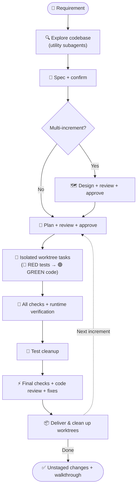

# dispatch-skills

[](package.json)
[](LICENSE)
[](package.json)

**Turn your coding agent into a multi-platform, end-to-end workflow orchestrator.** `dispatch-skills` lets your main agent delegate research to fast subagents, get designs, plans, and code reviewed by independent models across platforms, and build changes in isolated worktrees with automated testing, verification, and cleanup.

## Why dispatch-skills?

Most agent workflows ask one model to make the assumptions, write the code, and grade its own work. Dispatch separates those roles:

| Benefit | How Dispatch delivers it |
|---|---|
| **🎲 Independent perspectives** | Cross-platform reviewers run first and your host platform last, catching shared blind spots across model families. |
| **💡 Review designs & plans** | Designs and plans are reviewed before a single line is written, surfacing missing edge cases or migrations early. |
| **⚖️ Evidence, not votes** | Reviewers cite `file:L<line>` or plan sections; your host agent checks every claim against real code and rejects unsupported noise. |
| **🔴 Test-first & verified** | Writers capture failing tests (RED) before code, runtime verification proves behavior, and test cleanup prunes redundant tests. |
| **🌿 Isolated worktrees** | Parallel tasks run in isolated worktrees and deliver clean unstaged changes—never committing, pushing, or opening PRs. |
| **🛡️ Read-only delegates** | CLI delegates run sandboxed with ambient credentials stripped; only host-platform writers touch production code after approval. |
| **🧾 Lean context, lower cost** | Scripts handle routing, logs, and artifacts; cheap explorer subagents do heavy reading so your main context stays focused. |
| **🎚️ Proportional to risk** | Scale model tiers and review depth (`low`–`max`) to the task, with resumable sessions and optional token/cost diagnostics. |
| **💰 Spread usage across providers** | Mix Claude Code, Antigravity, GitHub Copilot, OpenCode, and Codex using the subscriptions or CLIs you already have. |

## How it works

Every workflow except a quick question (`ask`) starts by confirming one **spec**. Large cross-boundary work flows through a **design** and ordered increments; focused changes go straight to a **plan**.



- **Confirm before authoring:** You confirm the spec before any design or plan is written at every level.
- **Approve before coding:** At `medium` and above, you approve the plan or design before implementation; at `low`, Dispatch proceeds after spec confirmation and shows artifacts at handoff. See [document layers and approvals](skills/dispatch/references/readme/concepts.md#spec-design-and-plan).

## Quick start

```text
/dispatch [level] [(pins)] [ask|design|plan|review|implement|verify]: <argument>
```

Only the argument is required (default verb: `ask`).

- **Level** (`low`, `medium`, `high`, `xhigh`, `max`): sets model tiers and review depth. Omit it and Dispatch proposes one.
- **Pins** (`(claude,agy)`, `(3)`, `(all)`): choose which configured providers or target count answer.

```text
# Ask another model, or every configured model, a focused question
/dispatch: Trace discount stacking in src/domain/pricing.ts
/dispatch (all): Does the cache invalidation flow have a race?

# Write and review a plan
/dispatch high (claude,agy) plan: Add webhook idempotency

# Review uncommitted changes, or a Git commit range
/dispatch review code
/dispatch review code: main..HEAD

# Implement from a requirement or an approved plan/design
/dispatch implement: Add CSV export
/dispatch implement: .scratch/dispatch-skills/<folder>/csv.plan.md

# Large change: approve the design, then implement its increments
/dispatch design: Migrate the billing state machine
```

> [!NOTE]
> Dispatch works in isolated internal worktrees and delivers the verified result as **unstaged changes** in your checkout (see [design delivery](skills/dispatch/references/readme/implement.md#design-delivery) for increment commits). It never pushes or opens a PR. Session artifacts live under `.scratch/dispatch-skills/` so interrupted runs can resume.

## Install

Requires Node.js `^22.18 || >=23.6` and at least one supported agent CLI on your `PATH` (Claude Code, Antigravity, GitHub Copilot, OpenCode, or Codex).

```bash
# Latest from main
npx skills add Gyunikuchan/dispatch-skills -s '*'

# Specific branch or tag
npx skills add Gyunikuchan/dispatch-skills#<branch-or-tag> -s '*'
```

Copy `skills/dispatch/config.sample.jsonc` to `config.jsonc` (or `config.local.jsonc`) beside it, keep only the providers you use, and verify your setup (`<platform>` is `claude`, `agy`, `copilot`, `opencode`, or `codex`):

```bash
node skills/dispatch/scripts/dispatch.ts session init --objective "Check Dispatch setup" --host <platform>
node skills/dispatch/scripts/dispatch.ts doctor run --session <returned-session-path> --host <platform> --level high
```

> [!NOTE]
> - Install all skills in the same scope (all project-local or all global `-g`) so aliases can find sibling `dispatch`.
> - Exclude installed skill directories from formatters and linters; Dispatch verifies its own script and reference integrity.

## Skills & docs

Only `dispatch` runs the workflow; the aliases map familiar slash commands to `dispatch`.

| Skill | Purpose |
|---|---|
| [`dispatch`](skills/dispatch/README.md) | Full operational user guide (all verbs) |
| [`dispatch-plan`](skills/dispatch/references/readme/plan.md) | Alias for `/dispatch plan:` |
| [`dispatch-implement`](skills/dispatch/references/readme/implement.md) | Alias for `/dispatch implement:` |
| [`dispatch-verify`](skills/dispatch/references/readme/verify.md) | Alias for `/dispatch verify:` |
| [`dispatch-code-review`](skills/dispatch/references/readme/review.md) | Alias for `/dispatch review code:` |

- [Configuration](skills/dispatch/references/readme/configuration.md): levels, pins, model selection, sandboxing, and cost overrides
- [Troubleshooting](skills/dispatch/references/readme/troubleshooting.md): diagnostics, resuming interrupted runs, and common errors

## License

MIT © [Gyunikuchan](https://github.com/Gyunikuchan). See [LICENSE](LICENSE).
