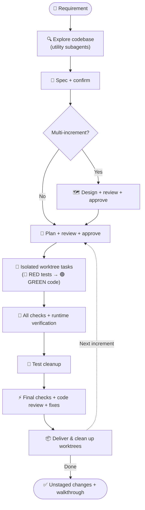

# Dispatch

Orchestrate multi-model research, planning, review, verification, and implementation from your current agent environment. Your **host agent** acts as your deputy: it routes exploration and routine tasks to utility subagents, questions and reviews to independent read delegates, and implementation to host-platform writers—checking all claims against the real code before acting.

## Contents

- [Before you start](#before-you-start)
- [Command pattern and verbs](#command-pattern-and-verbs)
- [Common workflows](#common-workflows)
- [What to expect in a run](#what-to-expect-in-a-run)
- [Configure routing](#configure-routing)
- [Safety, workspaces, and handoff](#safety-workspaces-and-handoff)
- [Troubleshooting](#troubleshooting)

## Before you start

Dispatch requires Node.js `^22.18 || >=23.6`, at least one authenticated provider CLI (`claude`, `agy`, `copilot`, `opencode`, or `codex`), and an active configuration file:

1. **Create your config:** Copy `config.sample.jsonc` beside this README to `config.local.jsonc` or `config.jsonc` (the sample is not loaded automatically; if both exist, `config.local.jsonc` wins without merging).
2. **Pick your models:** Keep only the providers you use and replace example model names with ones available to you. See the model hints in `config.sample.jsonc`:
   - `read-delegates`: required for `ask` and reviews (prefer strong reasoning models at `medium`+).
   - `utility-subagents`: required per platform in use (use a fast, cheap model with at least `medium` effort so exploration and cleanup are thorough).
   - `write-subagents`: required per platform in use (`doctor` blocks without it).
3. **Check your setup** from the repository root (`<platform>` is `claude`, `agy`, `copilot`, `opencode`, or `codex`):

```bash
node skills/dispatch/scripts/dispatch.ts session init --objective "Check Dispatch setup" --host <platform>
node skills/dispatch/scripts/dispatch.ts doctor run --session <returned-session-path> --host <platform> --level high
```

See [Configure Dispatch](references/readme/configuration.md) for levels, pins, and sandbox options.

## Command pattern and verbs

```text
/dispatch [level] [(pins)] [verb:] <question, requirement, artifact, or range>
```

| Part | Options | Notes |
|---|---|---|
| **Level** | `low`, `medium`, `high`, `xhigh`, `max` | Sets model tier and review depth. If omitted, Dispatch proposes `low`–`high` (`xhigh`/`max` are opt-in). |
| **Pins** | `(claude,agy)`, `(3)`, `(all)` | Optional per-run filter for providers or target count. |
| **Verb** | `ask` (default), `design`, `plan`, `implement`, `verify`, `review` | Start at any stage—for example, `implement` an existing plan. |

| Verb | When to use it | Output |
|---|---|---|
| [`ask`](references/readme/ask.md) | Focused codebase question | Independent analysis verified by your host agent |
| [`design`](references/readme/design.md) | Multi-increment or cross-boundary work | Spec + reviewed strategy & ordered increments |
| [`plan`](references/readme/plan.md) | One coherent unit of change | Spec + reviewed tactical plan with task criteria |
| [`implement`](references/readme/implement.md) | Deliver a requirement or approved plan/design | Verified code changes, code review, walkthrough |
| [`verify`](references/readme/verify.md) | Runtime proof of behavior | Executed checks, runtime evidence, and limits |
| [`review`](references/readme/review.md) | Existing design, plan, or code changes | Evidence-backed findings, accepted fixes, re-checks |

Not sure between `plan` and `design`? Dispatch grounds the scope and recommends one, or suggests switching if your choice does not fit.

## Common workflows

```text
# 1. Ask every configured model a focused question
/dispatch high (all): Could concurrent refreshes issue two valid tokens?

# 2. Plan, optionally re-review, and implement one change
/dispatch plan: Add idempotency keys to webhook delivery
/dispatch review: <path/to/change.plan.md>
/dispatch implement: <settled plan path>

# 3. Design and implement multi-increment work
/dispatch design: Migrate billing from mutable balances to a ledger
/dispatch implement: <approved design path>

# 4. Review uncommitted changes, or a Git commit range
/dispatch review code
/dispatch review code: main..HEAD

# 5. Verify runtime behavior
/dispatch verify: <plan or feature scope>
```

`plan:` already runs its configured review and fix rounds; the extra `review:` line is optional. Read the plan's task summaries and verification commands, then run `implement`. Without a range, `review code` inspects only uncommitted changes.

## What to expect in a run



1. **Ground and clarify:** Utility subagents explore relevant code first. Dispatch asks only open decisions that affect scope, behavior, or risk—laying out 2–3 approach options with a recommendation (including the simplest worth considering, each with its trade-off, limitation and risk)—then writes the **spec** for you to confirm.
2. **Author and review:** Dispatch grounds the confirmed scope, writes the **plan** or **design**, proposes a level if omitted, and sends the artifact to independent reviewers. Your host agent checks each cited finding and applies accepted fixes.
3. **Approve:** You confirm the spec before authoring at every level. At `medium` and above, you approve the plan or design before implementation; at `low`, Dispatch proceeds after spec confirmation and shows artifacts at handoff. The level may rise mid-run if complexity increases, never down.
4. **Build, verify, clean up, and review:** Writers implement each task (RED failing tests first, then GREEN) in isolated worktrees. After integration, Dispatch runs plan checks and **runtime verification**, runs **test cleanup** to prune redundant tests while preserving criterion coverage, then runs **final checks + code review** (with fix and re-check rounds if needed) before delivering and cleaning up worktrees.

> [!NOTE]
> `ask` skips spec confirmation, and standalone `review code` needs no approval gate. See [levels](references/readme/configuration.md#understand-levels-and-pins) and [document layers and approvals](references/readme/concepts.md#spec-design-and-plan).

### Canonical documents

| Document | Role |
|---|---|
| **Spec** | Mission brief: intent, constraints, decisions, and acceptance conditions |
| **Design** | Strategy: architecture, boundaries, risks, and ordered increments |
| **Plan** | Tactics: tasks, file ownership, prerequisites, `[SC<n>]` criteria, `Check:` commands |
| **Walkthrough** | Debrief: delivered behavior, changes, criterion evidence, and follow-ups |

**Reading tips:** Start with **At a Glance**; `> [!NOTE]` highlights key context and `> [!IMPORTANT]` marks a decision for you; expand `<details>` blocks for per-file breakdowns and full logs.

## Configure routing

| Setting | Controls |
|---|---|
| `read-delegates` | Provider targets and models for `ask` and reviews |
| `write-subagents` | Native writer models per platform (required for your host) |
| `utility-subagents` | Native explorer and utility models per platform (`context-limit` required) |
| `phases` | Optional review target counts, round limits, and provider filters |
| `write-concurrency` | Max concurrent task writers (default `1`) |
| `read-commands` | Optional host read commands (e.g. `codegraph explore`) allowed for read delegates |
| `diagnostics` | Optional `diagnostics.md` retrospective with time, token, and cost tables |
| `pricing` | Optional USD rate overrides for `diagnostics.md` cost estimates |

See [Configure Dispatch](references/readme/configuration.md) for full details and [rate overrides](references/readme/configuration.md#override-rates-for-cost-estimates).

## Safety, workspaces, and handoff

- **Read-only CLI delegates:** Run with ambient credentials stripped and OS sandboxing enabled where supported (`sandbox: false` disables it). A review voice on your host platform runs as a native subagent (prompt-restricted to its reply file, with checkout edits checked by the round diff).
- **Isolated worktrees & unstaged delivery:** Dispatch commits inside internal worktrees, then delivers the verified result as **unstaged changes** in your checkout (no commit, push, or PR; see [design delivery](references/readme/implement.md#design-delivery) for increment commits).
- **Session persistence:** Artifacts and state live under `.scratch/dispatch-skills/<folder>/`. Reusing the same chat resumes the session; see [Workspaces and results](references/readme/concepts.md).
- **Mid-run changes:** Completed work is preserved and your host agent re-evaluates affected checks; removing existing code requires your approval. See [When requirements change](references/readme/implement.md#when-requirements-change).

## Troubleshooting

| Problem | What to check |
|---|---|
| No delegates available | Run `doctor`; check `read-delegates`, provider CLI auth, and level |
| Unexpected model or review breadth | Check active config (`config.local.jsonc` vs `config.jsonc`), level, and pins |
| Doctor blocks or implementation cannot start | Add `write-subagents` and `utility-subagents` for your host platform; complete plan prerequisites |
| Code review finds no changes | Without a range, it reviews uncommitted changes; pass `base..head` for commits |
| Verification fails | Inspect the reported log path and follow the decision prompt |
| Provider or sandbox fails | Follow the `doctor` diagnostic, then verify CLI install and auth |

For step-by-step recovery, see [Troubleshooting](references/readme/troubleshooting.md).
