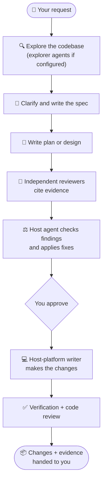

# Dispatch

Use Dispatch to bring independent agent perspectives into repository work without leaving your current agent environment. Your host agent checks delegates' evidence and makes the decisions; read delegates do not make production changes.

Dispatch can answer a focused question, help shape a design or plan, review existing work, or carry an approved change through implementation and verification.

## Contents

- [How Dispatch works](#how-dispatch-works)
- [Before you start](#before-you-start)
- [Choose a verb](#choose-a-verb)
- [Command pattern](#command-pattern)
- [Common workflows](#common-workflows)
- [Configure routing](#configure-routing)
- [Safety and session files](#safety-and-session-files)
- [Troubleshooting](#troubleshooting)

## How Dispatch works

Your current agent is the **host agent**. It routes work to configured read delegates, checks their evidence against the repository, and decides what to do with their findings.

A typical run:

1. **Understand the request.** Dispatch explores the relevant code first, using native explorer agents when `explore-subagents` is configured. If the [`grilling`](https://github.com/mattpocock/skills) skill is installed, it then asks you questions until no open decision remains. It writes a spec, confirms what it assumed, and recommends `plan` or `design`.
2. **Write and review.** Dispatch writes the plan or design, picks a level if you did not give one, and sends the artifact to reviewers. Your host agent checks their findings and applies accepted fixes.
3. **Approve.** At `medium` and above you approve the spec, the artifact, and any proposed level before implementation. At `low`, Dispatch shows them at handoff.
4. **Implement and verify.** A writer on your host platform makes the changes. Dispatch runs the plan's checks and a code review, then hands the result to you.

The level can go up during a run if the work proves harder, but never down. Questions (`ask`) need no spec, and code review of existing work needs no approval. See [levels](references/readme/configuration.md#understand-levels-and-pins) and [document layers and approvals](references/readme/concepts.md#spec-design-and-plan).



### Canonical documents

Dispatch organizes work across four canonical document layers:

- **Spec (Mission brief):** Captures intent, background, decisions, constraints, and desired outcomes. The governing contract read by all participants.
- **Design (Strategy):** Defines overarching architecture, boundaries, risks, and ordered delivery increments.
- **Plan (Tactics):** Details tactical execution for one coherent unit: tasks, file ownership, prerequisites, requirement-linked criteria, and verification commands.
- **Walkthrough (Debrief):** Records what was delivered, where to look, and how it was verified.

Reading tips for these documents:

- Start with **At a Glance**: the change, its purpose, and how it works.
- `> [!NOTE]` marks something you need to know; `> [!IMPORTANT]` marks a decision you must make.
- Expand `<details>` blocks for file changes, checks, and full evidence.
- Mermaid diagrams in VS Code need a preview extension.

## Before you start

You need Node.js `^22.18 || >=23.6`, at least one supported provider CLI installed and authenticated (Claude Code, Antigravity, GitHub Copilot, OpenCode, or Codex), and an active configuration with a read delegate.

For installation instructions, see the [repository README](../../README.md). Copy `config.sample.jsonc` beside the Dispatch skill as `config.local.jsonc` or `config.jsonc`, then replace example model names with ones available to you. The sample is not loaded automatically. If both files exist, `config.local.jsonc` takes precedence as a complete configuration; the files are not merged.

From the repository root, check your setup with:

```bash
node skills/dispatch/scripts/dispatch.ts session init --objective "Check Dispatch setup"
node skills/dispatch/scripts/dispatch.ts doctor run --session <returned-session-path> --level high
```

Questions and reviews use `read-delegates`. Implementation also needs a `write-subagents` entry for the platform running your host agent. See [Configure Dispatch](references/readme/configuration.md).

## Choose a verb

| Verb | Use it when… | Result |
|---|---|---|
| [`ask`](references/readme/ask.md) | You have a focused repository question | Independent analysis for your host agent to verify |
| [`design`](references/readme/design.md) | Work crosses boundaries or needs several increments | A spec, strategy and delivery outline with configured reviews |
| [`plan`](references/readme/plan.md) | The change is one coherent unit | A spec and tactical plan after configured review and fixes |
| [`review`](references/readme/review.md) | A design, plan, or code change already exists | Evidence-backed rulings, applied accepted fixes, and verification |
| [`implement`](references/readme/implement.md) | You want a requirement or approved artifact delivered | Approved changes, verification, review, and handoff |

Not sure between `plan` and `design`? Dispatch checks the scope and recommends one; if your choice looks wrong for the scope, it says why and suggests a switch. You can start at any step — for example, `implement` an existing plan.

## Command pattern

```text
/dispatch [level] [(pins)] [verb:] <question, requirement, artifact, or range>
```

- **Level**: `low`, `medium`, `high`, `xhigh`, or `max` — which configured models and how much review. If omitted, Dispatch proposes `low`–`high` for you to confirm; `xhigh` and `max` are only used when you ask. See [levels](references/readme/configuration.md#understand-levels-and-pins).
- **Pins**: provider names such as `(claude,agy)`, a target count such as `(3)`, or `(all)`.
- **Verb**: `ask` is the default; other choices are `design`, `plan`, `review`, and `implement`.
- **Argument**: a question, requirement, artifact path, or Git range.

## Common workflows

Ask a focused question:

```text
/dispatch high (all): Could concurrent refreshes issue two valid tokens?
```

Plan and deliver one change:

```text
/dispatch plan: Add idempotency keys to webhook delivery
/dispatch review: <path/to/change.plan.md>
/dispatch implement: <settled plan path>
```

`plan:` already reviews and fixes the plan as its level allows; the `review:` line is an optional extra pass. Read the plan's task summaries and verification commands, then run `implement`.

Design work that needs multiple increments:

```text
/dispatch design: Migrate billing from mutable balances to a ledger
/dispatch implement: <approved design path>
```

Review current or committed work:

```text
/dispatch review code
/dispatch review code: main..HEAD
```

Without a range, code review covers only uncommitted changes. Your host agent checks each finding, applies accepted safe fixes, then verifies and reviews again.

## Configure routing

| Setting | Controls |
|---|---|
| `diagnostics` | Optional shareable retrospective for Dispatch maintainers, with per-phase time and token tables; adds one retro turn per run when on |
| `write-concurrency` | Maximum number of implementation task writers running at once |
| `read-delegates` | Models used for questions and reviews |
| `write-subagents` | Native writer used by your host agent during implementation |
| `explore-subagents` | Optional native explorers for domain grounding before authoring |
| `phases` | Optional review breadth and round limits |

The [configuration guide](references/readme/configuration.md) covers setup, levels, pins, and sandbox settings.

## Safety and session files

- Read delegates run read-only, without your credential environment variables, and in an OS sandbox where the provider supports it. `sandbox: false` turns the sandbox off for that provider.
- Production changes use a writer configured for the host platform after the plan settles.
- Dispatch runs the verification commands declared in the plan. Review fixes are checked and reviewed again.
- Each chat keeps its artifacts under `.scratch/dispatch-skills/` in the workspace. The handoff reports the folder path; the same chat can reuse it if you continue later.
- Dispatch creates internal commits and delivers unstaged changes to your checkout; it does not commit on your branch, push, or open a pull request.

See [Workspaces and results](references/readme/concepts.md) for session files and verification.

If requirements change mid-run, completed work is kept and your host agent decides what to recheck; removing code needs your approval. See [Changing requirements](references/readme/implement.md#when-requirements-change).

## Troubleshooting

| Problem | What to check |
|---|---|
| No delegates are available | Run `doctor`; check `read-delegates`, provider authentication, and the requested level |
| The selected model or review breadth is unexpected | Check the active config, level, and pins |
| Implementation cannot start | Configure `write-subagents` for the host platform and complete the plan prerequisites |
| Code review finds no changes | Without a range, it reviews uncommitted changes; provide a Git range for committed work |
| Verification fails | Read the reported log and follow the decision Dispatch presents |
| A provider or sandbox fails | Follow the diagnostic, then check the active configuration and provider CLI installation/authentication |

For step-by-step help, see [Troubleshooting](references/readme/troubleshooting.md).
