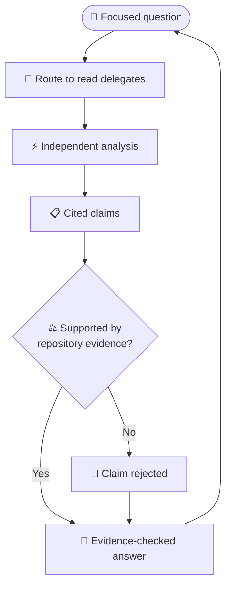

# Ask

Use `ask` when you have a focused question about code, behavior, or a decision in the repository.

`ask` is strictly user-initiated. Your host agent runs `ask` only when you explicitly request it; agents are barred from invoking `ask run` autonomously for their own internal research. For autonomous research, agents launch native [explorer subagents](../grounding.md) or [self-ground](../grounding.md#publish) when no explorer is configured.

Prominent non-exhaustive use cases include:
- **Cross-referencing and verification:** Verify factual claims, edge cases, and invariants across independent models against repository evidence.
- **Differentiated opinions and suggestions:** Gather diverse architectural perspectives, design trade-offs, and alternative approaches.

`ask` remains general-purpose for any inquiry where multiple independent provider perspectives help.

## What happens

Dispatch gathers independent analysis from configured read delegates across multiple models. Your host agent checks their claims against repository evidence and gives you an answer. An ask does not make repository changes.

### Flow at a glance



## How to use it

Ask a bounded question that names what you want to understand. You can omit the verb because `ask` is the default, or include `ask:` explicitly.

```text
/dispatch: Trace how expired sessions are removed
/dispatch high (all): Could concurrent refreshes issue two valid tokens?
```

Levels and provider pins are optional. See [Configure Dispatch](configuration.md) for routing and level settings.

## What next

Use [plan](plan.md) if the answer points to one coherent change, or [design](design.md) if the work needs ordered increments. Ask can also stand alone when you only need an explanation.
