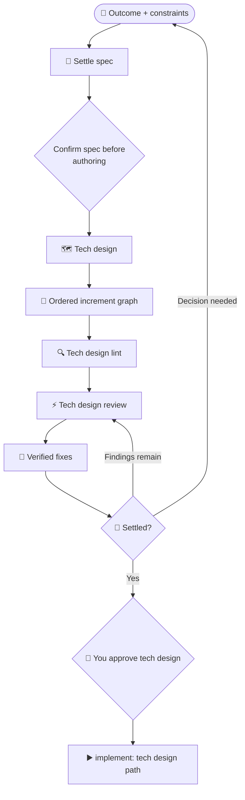

# Design

Use `design` when a change crosses components, has migration or rollback concerns, or needs several ordered increments.

Dispatch first settles the governing spec and asks you to confirm its exact contents before strategy authoring at every level. At `medium` and above, you also approve the design before implementation; at `low`, it is shown at handoff. The spec owns intent and your decisions. The design owns architecture and delivery increments and maps spec requirements to both. Increment plans own tactics, and implementation writers choose routine code mechanics. See [document layers](concepts.md#spec-design-and-plan).

If a review question changes intent, your host updates the spec and returns to design authoring or revision. Approve the revised design before its dependent increment plans resume; completed work and review history remain available.

Optional, advisory `Grounding leads:` carry tentative hints for planners to verify during increment grounding.

## What happens

Dispatch helps shape a design and delivery outline, with reviews selected by your configuration. You review the resulting design and settle its decisions before asking Dispatch to implement it.

### Flow at a glance



## How to use it

Describe the outcome and the important constraints. For example:

```text
/dispatch design: Migrate billing from mutable balances to a ledger
/dispatch implement: <approved design path>
```

The first command develops and reviews the design. After you approve it, pass its path to `implement` to deliver the increments in order.

## Choose between design and plan

Use [plan](plan.md) when the change can be delivered and verified as one coherent unit. Use design when the work needs an ordered delivery outline.
