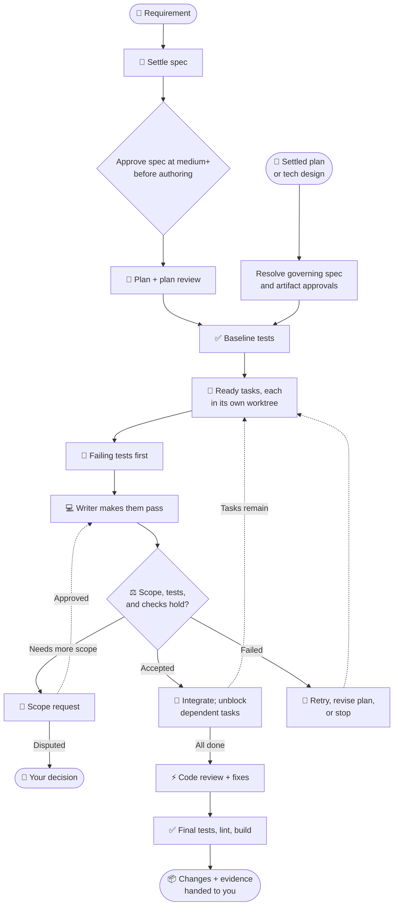

# Implement

Use `implement` to deliver a requirement or continue from a settled plan or approved design.

An objective first settles the spec, then authors a plan. At `medium` and above, approve the spec's exact contents before plan authoring; at `low`, it is shown at handoff. A supplied plan or design reuses its governing spec directly or through the design's Parent pin. Existing approvals are reused only for the versions they cover. See [document layers](concepts.md#spec-design-and-plan).

## What happens

After spec settlement, a plain-language requirement starts with a plan and its review and fix rounds enabled by the selected level's policy. The plan breaks the work into tasks with outcomes, criteria, owned paths, and prerequisites. Each task runs in an isolated worktree with a writer native to your host platform. Tasks with unmet prerequisites wait; independent tasks can overlap up to `write-concurrency` (default `1`).

For each task, the writer inspects the relevant code, adds discriminating tests for the task criteria, and captures the expected failing result (RED) before production edits. The host checks the actual delta and evidence. Missing RED is a review finding. Scope checks and current integrated verification are tool gates. The writer then implements the behavior and runs the task checks. Your host agent checks and integrates each result, then Dispatch runs final plan-declared verification and the configured code-review policy, when enabled. Accepted safe findings can be fixed and rechecked within the configured review rounds before Dispatch reports the handoff.

Final delivery restores the verified result into your caller working tree as unstaged changes. It makes no commit and stages nothing; new files show as untracked. Review with `git diff`, then stage and commit yourself. Your index must be empty, and no edited, untracked or ignored file of yours may overlap a delivered path; other changes of yours stay. A refusal preserves your work: inspect the result and reconcile the reported overlap before retrying. The verified source stays at `refs/dispatch/<id>/delivered-source`; restore a file with `git restore --source=refs/dispatch/<id>/delivered-source -- <path>`. If a crash interrupts a file write, retry can refuse and name that file; restore it with the same command. An already-delivered run returns the recorded result, while further changes need a new run. See [delivery and recovery](../toolkit.md#worktree-deliver).

### Flow at a glance



## How to use it

Describe the change you want, or pass the path to a settled plan or approved design.

```text
/dispatch implement: Add CSV export to the transactions page
/dispatch implement: <settled plan path>
/dispatch implement: <approved design path>
```

Implementation follows the artifact's prerequisites and recorded decisions. Independent tasks may run concurrently when `write-concurrency` is above one. The writer records observed RED failures before production edits; the contract does not require a separate refactor stage. If the host platform has no configured writer, see [Configure Dispatch](configuration.md).

## When requirements change

Ask your host agent to revise the spec when intent changes, then update its design or plan through the appropriate recovery path. The host checks the new contents and obtains new approval where required. Completed work and review history are preserved, and the host decides which checks to repeat. Design-owned work first revises and approves the design. Standalone implementation can return to its own plan authoring before tasks start; after tasks start it preserves work and stops for re-planning. A new prerequisite can require another check after that prerequisite finishes.

Removing a task from the plan does not remove its code. For example, dropping a completed reporting task keeps the report code until you approve its removal. See [Troubleshooting](troubleshooting.md) if work cannot continue.
