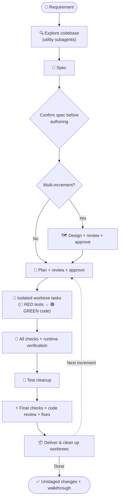

# Implement

Use `implement` to deliver a requirement or continue from a settled plan or approved design.

An objective first settles the spec, and you confirm its exact contents before plan authoring at every level. At `medium` and above, you also approve the plan or design before implementation; at `low`, Dispatch proceeds after spec confirmation and shows the plan at handoff. A supplied plan or design reuses its governing spec directly or through the design's Parent pin. Existing approvals are reused only for the versions they cover. See [document layers](concepts.md#spec-design-and-plan).

## What happens

1. **Plan & tasks:** After spec settlement, a plain-language requirement starts with a plan and its configured review/fix rounds. Tasks define outcomes, criteria, owned paths, and prerequisites; each runs in an isolated worktree with a native host writer (up to `write-concurrency`, default `1`).
2. **Test-first & integration:** For each ready task, the writer adds discriminating tests and captures the expected failing result (**RED**) before production edits (missing RED is a review finding), then implements the behavior (**GREEN**) and runs task checks. Your host agent checks the delta and integrates each result.
3. **Verify, clean up & review:** After all tasks integrate, Dispatch runs all-criteria checks and runtime verification. Next, **test cleanup** runs (cleanup starts without a full check run unless the verifier commit changed an undeclared path—otherwise checking only automated criteria whose declared paths changed), followed by final plan-declared checks together with code review. Accepted safe findings are fixed and re-checked within configured rounds.
4. **Deliver & clean up worktrees:** The verified result is restored into your caller working tree as **unstaged changes** (no commit or staging by default; new files show as untracked), and internal worktrees are cleaned up. Review with `git diff`, then stage and commit yourself unless you opted in to design increment commits.
   - Delivery requires an empty index and no overlapping edited, untracked, or ignored files (other changes stay; a refusal preserves your work).
   - The verified source remains at `refs/dispatch/<id>/delivered-source` (`git restore --source=refs/dispatch/<id>/delivered-source -- <path>`). An already-delivered run returns the recorded result; further changes need a new run. See [delivery and recovery](../toolkit.md#worktree-deliver).

### Flow at a glance



## How to use it

Describe the change you want, or pass the path to a settled plan or approved design.

```text
/dispatch implement: Add CSV export to the transactions page
/dispatch implement: <settled plan path>
/dispatch implement: <approved design path>
```

Implementation follows the artifact's prerequisites and recorded decisions. Independent tasks may run concurrently when `write-concurrency` is above one. The writer records observed RED failures before production edits; the contract does not require a separate refactor stage. If the host platform has no configured writer, see [Configure Dispatch](configuration.md).

## When requirements change

Ask your host agent to revise the spec when intent changes, then update its design or plan through the appropriate recovery path. The host checks the new contents and obtains new approval where required. Completed work and review history are preserved, and the host decides which checks to repeat. Design-owned work first revises and approves the design. Standalone implementation can return to its own plan authoring before tasks start; after tasks start it preserves work and stops for re-planning. A new prerequisite can require another check after that prerequisite finishes.

Removing a task from the plan does not remove its code. For example, dropping a completed reporting task keeps the report code until you approve its removal. See [Troubleshooting](troubleshooting.md) if work cannot continue.

## Design delivery

For a supplied design, Dispatch delivers increments in dependency order, each in its own retained session. The all-increments opt-in permits a local caller commit after each delivery. Without it, you commit each increment (an empty commit for a no-op) before the next begins. Dispatch reports any post-commit differences.
