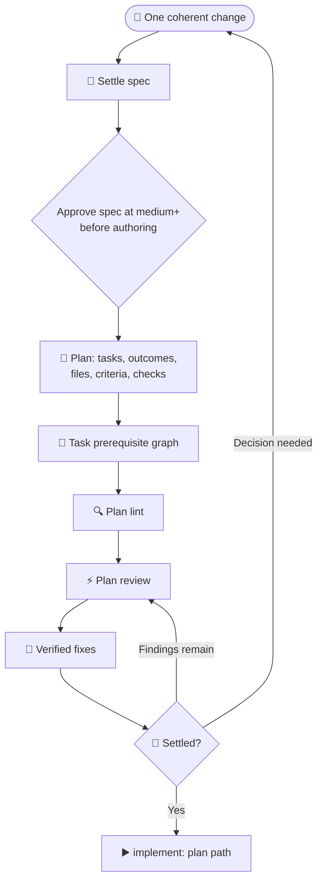

# Plan

Use `plan` when the change can be delivered and verified as one coherent unit.

Dispatch first settles a governing spec and, at `medium` and above, asks you to approve its exact contents before plan authoring. At `low`, it proceeds and shows the spec at handoff. A standalone plan pins that spec version; an increment plan names its governing design increment, and the design pins the spec. Each success criterion names the spec requirements it proves. See [document layers](concepts.md#spec-design-and-plan).

If intent changes during standalone planning, the host updates the spec and returns to plan authoring. A stale increment plan needs design revision first. Approve the new spec contents where required before authoring continues; older approval does not cover a changed version.

## What happens

Dispatch helps identify the outcomes, affected files, prerequisites, and verification steps, then runs the plan review and fix rounds enabled by your level's `plan-review` policy. A level configured with zero targets or rounds can skip plan review. Read the settled plan and its verification commands, then run `implement` to begin.

### Flow at a glance



## How to use it

Describe the behavior you want, its constraints, and how you will know it is complete.

```text
/dispatch plan: Add idempotency keys to webhook delivery
/dispatch review: <path/to/change.plan.md>
/dispatch implement: <settled plan path>
```

The separate review command is an optional additional pass; `.plan.md` lets Dispatch infer that the target is a plan. For work that needs ordered delivery increments, use [design](design.md) instead.
