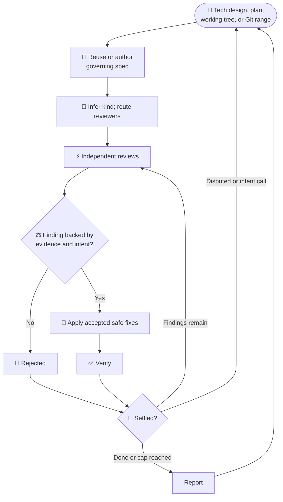

# Review

Use `review` when a design, plan, working tree, or Git range already exists and you want evidence-backed findings.

Every review has a governing spec. Dispatch follows an artifact's governing references or reuses the session spec. If none exists, your host writes it from the full discussion and the diff, labels inferred requirements, and records your decisions only with evidence. Standalone code review adds no authoring approval gate. Reviewers read the whole spec; supply intended outcomes there instead of the removed `--context` option. See [document layers](concepts.md#spec-design-and-plan).

Design and plan reviews assess intent first: missing requirements, contradicted decisions and flawed assumptions. Your host settles findings from the spec and recorded decisions where possible, and asks you when evidence leaves intent unresolved. An answer that changes intent updates the spec and can require re-planning or design revision before review resumes. Completed work and review history are preserved; [recovery guidance](troubleshooting.md#resolve-spec-and-intent-changes) explains each case.

## What happens

In every review, your host agent adjudicates findings, applies accepted safe fixes, and verifies and reviews the changes again under the [review rounds policy](../review-rules.md#review-provenance-and-applicability). Disputed or intent-dependent findings can still be escalated to you.

### Flow at a glance



## How to use it

Name what you want reviewed. For code, no range means uncommitted changes; provide a Git range to include committed work.

```text
/dispatch review: <path/to/system.design.md>
/dispatch review: <path/to/change.plan.md>
/dispatch review code
/dispatch review code: main..HEAD
```

The `.plan.md` and `.design.md` extensions let Dispatch infer the target type; other paths default to code review. Your host agent evaluates findings against the work's intended outcome. See [review rules](../review-rules.md) for how findings are assessed and resolved.

## When the target changes

Existing findings remain available when files change. Your host agent decides whether they still apply or whether another review is needed. The report distinguishes what reviewers inspected from later changes the host judged safe to reuse.
