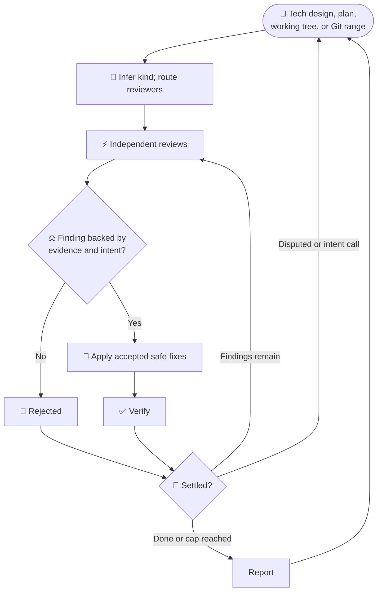

# Review

Use `review` when a design, plan, working tree, or Git range already exists and you want evidence-backed findings.

## What happens

In every review, your host agent adjudicates findings, applies accepted safe fixes, and verifies and reviews the changes again within the configured round limit. Disputed or intent-dependent findings can still be escalated to you.

### Flow at a glance



## How to use it

Name what you want reviewed. For code, no range means uncommitted changes; provide a Git range to include committed work.

```text
/dispatch review: <path/to/system.design.md>
/dispatch review: <path/to/change.plan.md>
/dispatch review code
/dispatch review code: main..HEAD
```

The `.plan.md` and `.design.md` extensions let Dispatch infer the target type; other paths default to code review. Your host agent evaluates findings against the work's intended outcome. See [review rules](../review-rules.md) for how findings are assessed and resolved.

## When the target changes

Existing findings remain available when files change. Your host agent decides whether they still apply or whether another review is needed. The report distinguishes what reviewers inspected from later changes the host judged safe to reuse.
