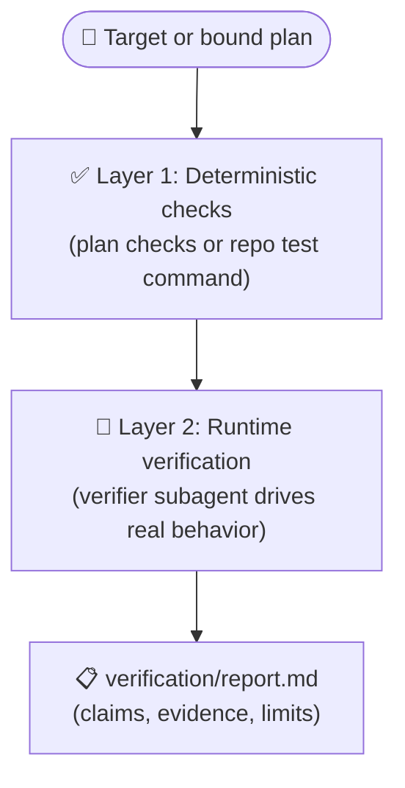

# Verify

Use `/dispatch verify: <target>` to run deterministic checks and prove delivered behavior at runtime against its governing intent.

## How it works



- **Two layers:** Dispatch runs deterministic checks first (`check run` when a bound plan and session integration exist, or the repository's own test command as a baseline), then launches a verifier subagent for runtime verification.
- **When it runs automatically:** `implement` runs verification after all tasks integrate and before test cleanup; after code review settles, it re-checks proved behavior changed by accepted review fixes.
- **Artifacts & limits:** Proof and logs live under the session's `verification/report.md` and `verification/`, linked from the walkthrough. If nothing runnable can be proved, Dispatch records a no-op explaining why. Missing tools are reported as limits—Dispatch does not install them.

For approval rules on actions that change persistent or shared state, send messages, incur charges, or use non-local environments, see [the verify guide](../verbs/verify.md).

## Optional host rule guidance

Add a `## Verification` section to your host rule file to give the verifier repository-specific instructions for launch, health checks, driving flows, evidence, and cleanup:

```markdown
## Verification
- **Launch:** Start the local service with the repository's documented boot command and wait until it accepts requests.
- **Health check:** Query the read-only status endpoint before driving any scenario.
- **Drive:** Exercise the documented user workflow using the disposable test account from the setup guide.
- **Evidence:** Save logs and captured responses in the session's verification directory.
- **Cleanup:** Stop only the instance started for this run while keeping captured evidence intact.
```
