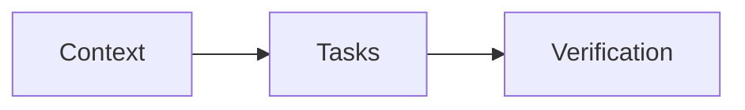

# Plan template

External delegates read the plan file with no other context.

Keep deliverables at the root of `.scratch/dispatch-skills/<folder>/`, tool results in `.state/results/`, and records in `ledger.jsonl`, retaining the session in the workspace.

Separate summary fields with blank `>` lines so each field renders as its own paragraph.

````markdown
# <Goal Description>

> **TL;DR:** <problem and outcome>
>
> **Parent:** <`<design path>` · I<nn> | `<spec path>` · sha256:<hex>>
>
> **Decide:** <reader decision, or none>
>
> **Risk:** <low|med|high> — <reason>
>
> **Scope:** <paths or components>

## At a Glance
- **What:** <plain-language change and why it matters>
- **How it works:** <one-line explanation>



Text summary: Tasks apply the change, then verification checks the outcome.

## Background
*Optional: current behaviour a fresh reader needs, with `file:line` pointers.*

## Key Interfaces & Data
- <optional contract sketch, data shape or layout tree needed by every task>

## Key Decisions & Context
*Tactical decisions with rationale; cite spec DEC-<n> and design AD-<n> by ID.*

## Constraints
- <shared limit every task must preserve>

## Open Questions & Assumptions
*Tactical assumptions and defaults. Open user questions belong in the governing spec Open Questions.*

## Out of Scope
*Plan-local exclusions and deferred follow-ups.*

## Task Map

| ID | Title | Outcome | Prerequisites | Criteria |
| --- | --- | --- | --- | --- |
| T<n> | <Task title> | <Plain-language outcome> | none | SC<n>[, SC<n>...] |

## Technical-Design Traceability
- Approved revision: `sha256:<64 hex>`
- Increment ID and inherited contract: I<nn> — <inherited outcome, invariants, rollback boundary>
- Prerequisite evidence: <prerequisite completion evidence>
- Acceptance mapping: <change / test → acceptance criterion>

## Proposed Changes

### T<n> — <Task title>
- Constraints: <optional task-specific constraints, including why each non-obvious prerequisite is needed>
- Overlap: <path> — <why this unordered task also writes the path>

<details>
<summary>Create, update and remove the owned files (4 files)</summary>

- #### [NEW] <relative-path>
  - Purpose: Public interface and rationale.
  - Reuse: <existing equivalents searched and why not reused, or none found>

- #### [MODIFY] <relative-path>
  - Changes: Concrete symbol/signature and behavior changes.
  - Invariants: Preserved pre/post-conditions; exception: <file-specific exception>.

- #### [DELETE] <relative-path>
  - Changes: Deleted symbols and cleanup.

- #### [GENERATED] <relative-path>
  - Command: `<generator command>`
  - Inputs: <relative-path>[, <relative-path>...]

</details>

## Success Criteria
- [SC1] <checkable outcome>
  <details>
  <summary>Checks</summary>

  - Satisfies: REQ-<n>[, REQ-<n>...]
  - Changes: <relative-path>[, <relative-path>...]
  - Tests: <relative-path>[, <relative-path>...]
  - Verify: `<command>` [FINAL]
  - RED: `<focused command>`
  - Evidence: <red|verify|review>
  - Retain: <transient|durable>
  - Covered by: <SC#|FINAL>
  - Pre-existing: <yes|no>
  - RED exception: <behavior-preserving|already-satisfied>
  - Test rationale: <why durable declared tests meet the [code test policy](quality-bar.md#code)>
  - Review: <artifact: path; scenario: bounded inspection; pass: observable condition>
  - Enforcement infeasibility: <why deterministic enforcement is infeasible>
  - Integration: <why this criterion spans tasks>

  </details>

## Verification Plan
- Seams: <test entry point>[, <test entry point>...]
### Automated Tests
- `<one executable command>`
- None: <reason>
### Manual Verification
- Manual steps, edge cases, and failure scenarios.

## Rollback & Blast Radius
*Caller impacts, migrations, and rollback paths; omit when empty.*

## Review Findings & Resolutions
*No reviews conducted yet.*

````

## Field notes

- Human layout: apply the [quality bar's authoring rules](quality-bar.md#spec). Place `> [!NOTE]` and `> [!IMPORTANT]` callouts inside sections; select their type under those rules.

- Omit optional empty prose sections. Retain required machine sections and conditional fields when applicable.
- Keep the template section order: At a Glance first, then shared context and decisions, then task outcomes and execution detail. A present section out of order is a `section-order` warning; absent optional sections are ignored. Keep interfaces, ownership, prerequisites, failure behavior, compatibility, exact commands and criterion-to-check traceability. Use no fixed word limit or second human plan.
- Put task ID, title, outcome, prerequisites, and criteria in the authored Task Map. Join rows to Proposed Changes by ID; titles must match the task headings. Put task-specific Constraints and Overlap under the matching task. Put mandatory file constraints and exceptions under Invariants:; these labels and their continuation bullets enter owned writer briefs. Other notes remain in full-plan context.
- Review history: follow [review rules](../review-rules.md); retain findings and rulings in the ledger and summarize their resolutions in this plan.
- Shared range: At a Glance, Background, optional Key Interfaces & Data, decisions, shared Constraints and Task Map precede task detail. Every task writer reads the plan from its start through `## Task Map`, then only its own task, criteria and Verification Plan rows. The authored map is part of the governed plan hash and shared writer context. Put context that all tasks need in the shared range and task-specific detail under the task.

- Collapsed detail: wrap each task's file entries and each criterion's machine fields in `<details>` with a plain `<summary>`. Keep wrapper tags on separate lines, with blank lines after `</summary>` and before `</details>` so Markdown renders on GitHub. Indent criterion wrappers and fields by two spaces; retain field names and file headings.
- Technical-Design Traceability: increment plans only.
- Verify: list only this criterion's tests. Select by literal behavior title with the project runner's filter (e.g. `npx jest tests/a.test.ts -t "<title>"`, `pytest tests/test_a.py -k "<name>"`) and fail on zero selected tests; red never runs the aggregate suite. `[FINAL]` (optional, after the closing backtick, never inside it) marks a broad or slow required gate; leave narrow feedback commands unmarked. A Verify command or test file name that contains a criterion or finding ID is a `plan-id-in-test-name` warning.
- Task Map: author one table with columns ID, Title, Outcome, Prerequisites, Criteria. Use `none` when a task has no prerequisites. Separate multiple task or criterion IDs with commas. Escape literal pipes as `\|`, including inside inline code. Rows join task sections by ID, not position. Keep Paths and Overlap in task details; keep task-specific Constraints under the task; put shared Constraints in the shared section. Toolkit lint and brief tools read the table as authored and never rewrite it. Map edits change the governed plan hash; only Review Findings & Resolutions are excluded.
- Review Findings & Resolutions: record findings, rulings, and verification evidence after review.
- Tests: the criterion's runnable test files plus every support file (helper, fixture, mock) its RED stage changes or needs, each also in its Changes. Support files (paths under `fixtures/`, `helpers/`, or `mocks/`) need no `[NEW]` action or `transient` name. A red criterion without Tests (and without RED exception) is a `criterion-red-test-path` warning; a Tests path outside Changes is a `criterion-tests-path` warning; a test-like Changes path in no criterion's Tests is an `undeclared-test-path` warning (support paths are exempt).
- RED: the focused executable command that fails before the change, for any test tool (e.g. `npx jest tests/parser.test.ts -t "<title>"`, `pytest tests/test_parser.py -k "<name>"`). Generated capture commands expand `{files}` only from the criterion's Tests, quoted for the subprocess shell. When Tests includes non-runnable support files, name runnable paths explicitly in RED. Record observed failures in the writer report. Missing RED evidence becomes a review finding. A missing or malformed code span is a `criterion-red-command` warning; a red criterion with neither RED nor RED exception is a `red-downgraded` warning.
- Optional: Pre-existing `yes` identifies a baseline red failure; RED exception (red only) records a no-failing-state rationale; Review is required for review; missing Enforcement infeasibility for critical review is a warning.
- Tasks: every H4 belongs to one task. Under `## Proposed Changes`, use H3 only for `### T<n> — <title>` task headings; the parser reads every H3 there as a task. Put a short human change summary in `<summary>` directly before the file entries. Use the plan criteria in [quality-bar.md](quality-bar.md#plan) to judge outcomes and task boundaries. Record shared-resource dependencies (ports, caches, outputs) as prerequisites with a rationale.
- Overlap: a write path repeated by tasks with no transitive prerequisite path is an `overlap` warning (case variants count as one path; references never count). Order the tasks, or justify each shared path with `Overlap:` on the task. A repeat inside one task is a `duplicate-change-path` defect.
- Seams: existing public test entry points that criteria verify through; the orchestrator chooses them from current tests and checks each criterion's Verify against them.
- Retain: required on every criterion whose Changes names a test path declared in Tests; prefer `transient` for intermediate step, helper and branch-permutation checks. `transient` tests prove one step; their test files are `[NEW]` paths that no durable criterion lists, named with `transient` under the runner's convention (`x.transient.test.ts`, `x_transient_test.go`, `tests/test_x_transient.py`). Move a transient test out of any shared or durable file into its own `[NEW]` transient-named file. Inline-only test forms (Rust `#[cfg(test)]`, doctests) must be durable or move to a separate test file. Transient criteria require `Covered by:` naming a durable criterion or `FINAL` that keeps the behavior covered. Every plan with transient criteria needs at least one explicit nonempty `[FINAL]` Verify command, even when Covered by names a durable criterion. Before removal, review must judge that the named durable or FINAL coverage protects the high-value behavior; a green suite alone cannot detect missing protection. After integrated verification and resolution of code-review findings, remove declared transient test files and run required checks on the final tree before delivery.
- Test rationale: required only when Tests names files retained as durable; omission is a warning. Apply the [quality bar's code test policy](quality-bar.md#code); a shared rationale names each test and its distinct boundary. Keep requirement-to-criterion traceability; one durable test per requirement is not required.
- Criteria mapping: each criterion is listed by exactly one task, whose paths cover its Changes, or carries Integration (with Verify) when it spans tasks. A task-owned criterion needs Changes naming the task paths it proves; a task-owned criterion with Verify alone is a `criterion-task-changes` defect.
- `[DELETE]`: may group comma-separated paths under one heading with one shared reason (`#### [DELETE] a.ts, b.ts`); `[NEW]`, `[MODIFY]` and `[GENERATED]` use one heading per path.
- Reuse: on `[NEW]` entries and on `[MODIFY]` entries that add an exported or shared symbol, helper, module, or type, apply the [quality bar's shared reuse criterion](quality-bar.md#shared). Record the names searched and why none was reused, or write `none found`. Writer briefs omit `Reuse:`; put a reuse decision that binds the writer in `Changes:` or `Purpose:`.
- Affected checks: criterion RED/Verify selectors give fast feedback; they do not replace full checks of modified logical test files or known impacted consumers before aggregate. Authors list those fast checks under Automated Tests. Writers follow the [writer brief](writer-brief.md).
- Automated Tests: list fast commands. Each one that no criterion lists is a contract command: writers run it before they submit, and `verify run` records it against the integrated tree. Put broad or slow gates in a criterion Verify marked `[FINAL]`.
- `[GENERATED]`: name the Command and Inputs needed to reproduce the output; a task producing an Input must be a (transitive) prerequisite. Run the generator before verification.

- Satisfies: name the governing spec REQ IDs on every criterion; missing or unknown references are warnings.
