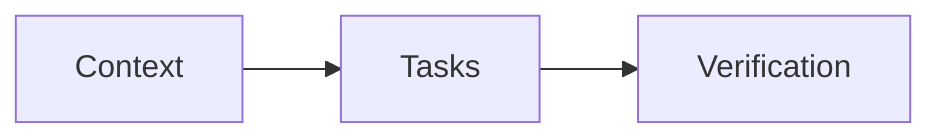

# Plan template

External delegates read the plan file with no other context.

Keep deliverables at the root of `.scratch/dispatch-skills/<folder>/`, tool results in `.state/results/`, and records in `ledger.jsonl`, retaining the session in the workspace.

Separate each box field with blank `>` lines so it renders as its own paragraph.

````markdown
# <Goal Description>

> **Parent:** <`<design path>` · I<nn> | `<spec path>` · sha256:<hex>>
>
> **Decide:** <reader decision, or none>
>
> **Risk:** <low|med|high> — <reason>
>
> **Scope:** <components or top-level paths>

## At a Glance
- **What:** <plain-language change and why it matters>
- **How it works:** <one-line explanation>

*Optional orientation visual, only when the visual-aid bar admits it:*



Text summary: Tasks apply the change, then verification checks the outcome.

## Background
*Optional: current behaviour a fresh reader needs, with `file:line` pointers.*

## Key Interfaces & Data
- <optional contract sketch, data shape or layout tree needed by every task>

## Key Decisions & Context
*Tactical decisions with rationale; cite spec DEC-<n> and design AD-<n> by ID.*

## Constraints
- <shared limit every task must preserve>

## Open Questions & Assumptions
*Tactical assumptions and defaults. Open user questions belong in the governing spec Open Questions.*

## Out of Scope
*Plan-local exclusions and deferred follow-ups only.*

## Task Map

| ID | Title | Outcome | Prerequisites | Criteria |
| --- | --- | --- | --- | --- |
| T<n> | <Task title> | <Plain-language outcome> | none | SC<n>[, SC<n>...] |

## Technical-Design Traceability
- Approved revision: `sha256:<64 hex>`
- Increment ID and inherited contract: I<nn> — <inherited outcome, invariants, rollback boundary>
- Prerequisite evidence: <prerequisite completion evidence>
- Acceptance mapping: <change / test → acceptance criterion>

## Proposed Changes

### T<n> — <Task title>
- Constraints: <optional task-specific constraints, including why each non-obvious prerequisite is needed>
- Overlap: <path> — <why this unordered task also writes the path>
- <Observable behaviour this task implements and how it works.>


Text summary: Optional visual under the visual-aid bar.

<details>

- #### [NEW] <relative-path>
  - Purpose: Public interface and rationale.
  - Reuse: <existing equivalents searched and why not reused, or none found>

- #### [MODIFY] <relative-path>
  - Changes: Concrete symbol/signature and behavior changes.
  - Invariants: Preserved pre/post-conditions; exception: <file-specific exception>.

- #### [DELETE] <relative-path>
  - Changes: Deleted symbols and cleanup.

- #### [GENERATED] <relative-path>
  - Command: `<generator command>`
  - Inputs: <relative-path>[, <relative-path>...]

</details>

## Success Criteria
- [SC1] <checkable outcome>
  <details>

  - Satisfies: REQ-<n>[, REQ-<n>...]
  - Changes: <relative-path>[, <relative-path>...]
  - Tests: <relative-path>[, <relative-path>...]
  - Check: `<command>`
  - RED: `<focused command>`
  - Evidence: <red|check|review>
  - Pre-existing: <yes|no>
  - RED exception: <behavior-preserving|already-satisfied>
  - Review: <artifact: path; scenario: bounded inspection; pass: observable condition>
  - Enforcement infeasibility: <why deterministic enforcement is infeasible>
  - Integration: <why this criterion spans tasks>

  </details>

## Verification Plan
- Seams: <test entry point>[, <test entry point>...]
### Automated Tests
- `<one executable command>`
- None: <reason>
### Manual Verification
- Manual steps, edge cases, and failure scenarios.

## Rollback & Blast Radius
*Include inspected callers or consumers the plan leaves unchanged when they matter for review, plus migrations and rollback paths; omit when empty.*

## Review Findings & Resolutions
*No reviews conducted yet.*

````

## Field notes

Notes that explain a lint code live in [plan field notes](plan-field-notes.md); read the note when that code is reported.

- Layout: follow [authoring rules](quality-bar.md#spec); put `> [!NOTE]` and `> [!IMPORTANT]` callouts inside sections.

- Scope: name components or top-level paths, not per-criterion file lists; each criterion's files belong in its Changes and Tests.

- Out of Scope and Rollback & Blast Radius: keep Out of Scope to plan-local exclusions and deferred follow-ups; put affected consumers, reversibility and persistent effects in Rollback & Blast Radius when material, including inspected callers left unchanged.

- Omit optional empty prose sections. Retain required machine sections and conditional fields when applicable.

- Task Map titles must match the task headings. Put task-specific Constraints and Overlap under the matching task. Put mandatory file constraints and exceptions under Invariants:; these labels and their continuation bullets enter owned writer briefs. Other notes remain in full-plan context.

- Shared range: At a Glance, Background, optional Key Interfaces & Data, decisions, shared Constraints and Task Map precede task detail. Writers use the embedded Shared plan context, Task scope, Criteria, Contract commands and RED capture commands from their [writer brief](writer-brief.md), reading the whole plan only when `Constraints:`, `Overlap:` or `Invariants:` references another task or a shared producer/consumer interface outside these sections. Put context that all tasks need in the shared range and task-specific detail under the task. For document-writing tasks, name actionable authoring-reference paths in shared context or the assigned task, relative to the repository/worktree or explicitly to the governing plan; check each path before launch.

- Visual placement: put common orientation in the shared range, data shapes in Key Interfaces & Data, and task-local views after behaviour bullets. A task diagram's text summary is a `Text summary:` line and not a bullet. A depicted unchanged component is context, not a writer-owned path. A plan may include diagrams with or without a parent design; judge each visual with the [visual-aid bar](quality-bar.md#visual-aid-bar).

- Format changes: when a task introduces a format, show its exact shape and producer/consumer contracts; when it changes one, show concrete proposed before and after shapes and affected contracts when useful. Label verification as planned until executed.

- Collapsed detail: wrap each task's file entries and each criterion's machine fields in `<details>` without a summary line. Keep wrapper tags on separate lines with a blank line after the opening tag and before the closing tag. Indent criterion wrappers and fields by two spaces; retain field names and file headings.

- Technical-Design Traceability: increment plans only.

- Task Map: author one table with columns ID, Title, Outcome, Prerequisites, Criteria. Use `none` when a task has no prerequisites. Separate multiple task or criterion IDs with commas. Escape literal pipes as `\|`, including inside inline code. Rows join task sections by ID, not position. Keep Paths in task details and shared Constraints in the shared section. Toolkit lint and brief tools read the table as authored and never rewrite it. Map edits change the governed plan hash; only Review Findings & Resolutions are excluded.

- Review Findings & Resolutions: generated under [review rules](../review-rules.md); do not edit manually.

- Optional: Pre-existing `yes` identifies a baseline red failure; RED exception (red only) records a no-failing-state rationale; Review is required for review; missing Enforcement infeasibility for critical review is a warning.

- Tasks: every H4 belongs to one task. Under `## Proposed Changes`, use H3 only for `### T<n> — <title>` task headings; the parser reads every H3 there as a task. Put task behaviour bullets before `<details>` and file entries inside it. Author to the [plan standard](quality-bar.md#plan): it judges outcomes, task boundaries and which decisions the plan binds. Record shared-resource dependencies (ports, caches, outputs) as prerequisites with a rationale.

- Seams: existing public test entry points that criteria check through; the orchestrator chooses them from current tests and checks each criterion's Check against them.

- `[DELETE]`: may group comma-separated paths under one heading with one shared reason (`#### [DELETE] a.ts, b.ts`); `[NEW]`, `[MODIFY]` and `[GENERATED]` use one heading per path.

- Reuse: on `[NEW]` entries and on `[MODIFY]` entries that add an exported or shared symbol, helper, module, or type, apply the [quality bar's shared reuse criterion](quality-bar.md#shared). Record the names searched and why none was reused, or write `none found`. Writer briefs omit `Reuse:`; put a reuse decision that binds the writer in `Changes:` or `Purpose:`.

- Affected checks: criterion RED/Check selectors give fast feedback; list other fast affected-file checks under Automated Tests (lint rejects an exact repeat). Writers run affected checks per the [writer brief](writer-brief.md).

- Automated Tests: list fast commands. Each one that no criterion lists is a contract command: writers run it before they submit, and `check run` records it against the integrated tree. Put broad or slow gates in a criterion Check.

- `[GENERATED]`: name the Command and Inputs needed to reproduce the output; a task producing an Input must be a (transitive) prerequisite. Run the generator before verification. Own each golden or generated output that renders an edited file, and each file whose line budget or byte cap the change can exceed, as a `[MODIFY]` or `[GENERATED]` entry of the task that changes it; an unowned output forces a mid-run plan edit.

- Satisfies: name the governing spec REQ IDs on every criterion; missing or unknown references are warnings.
